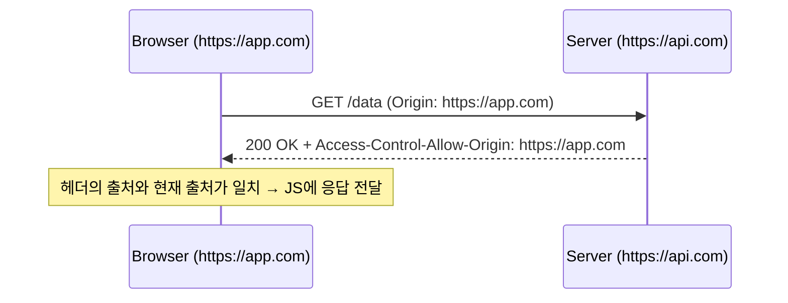
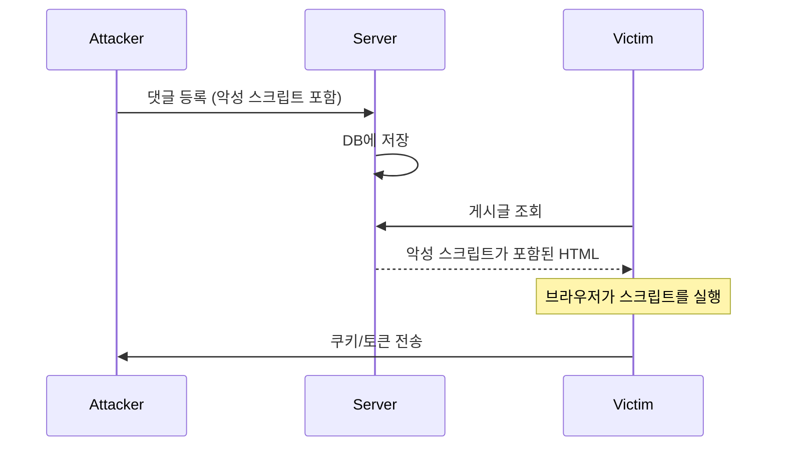
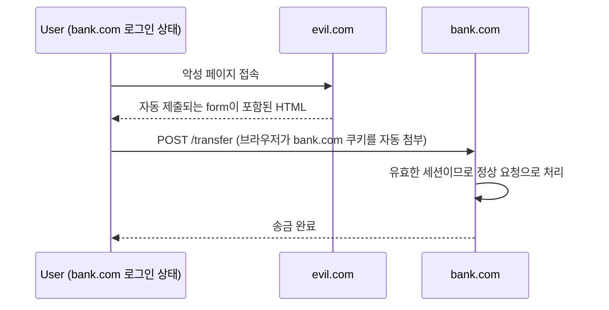
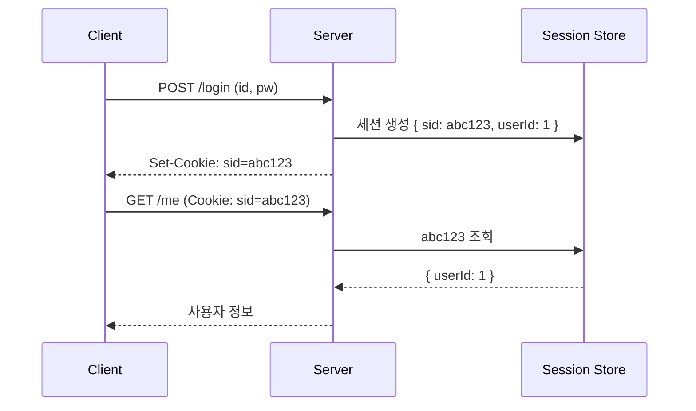
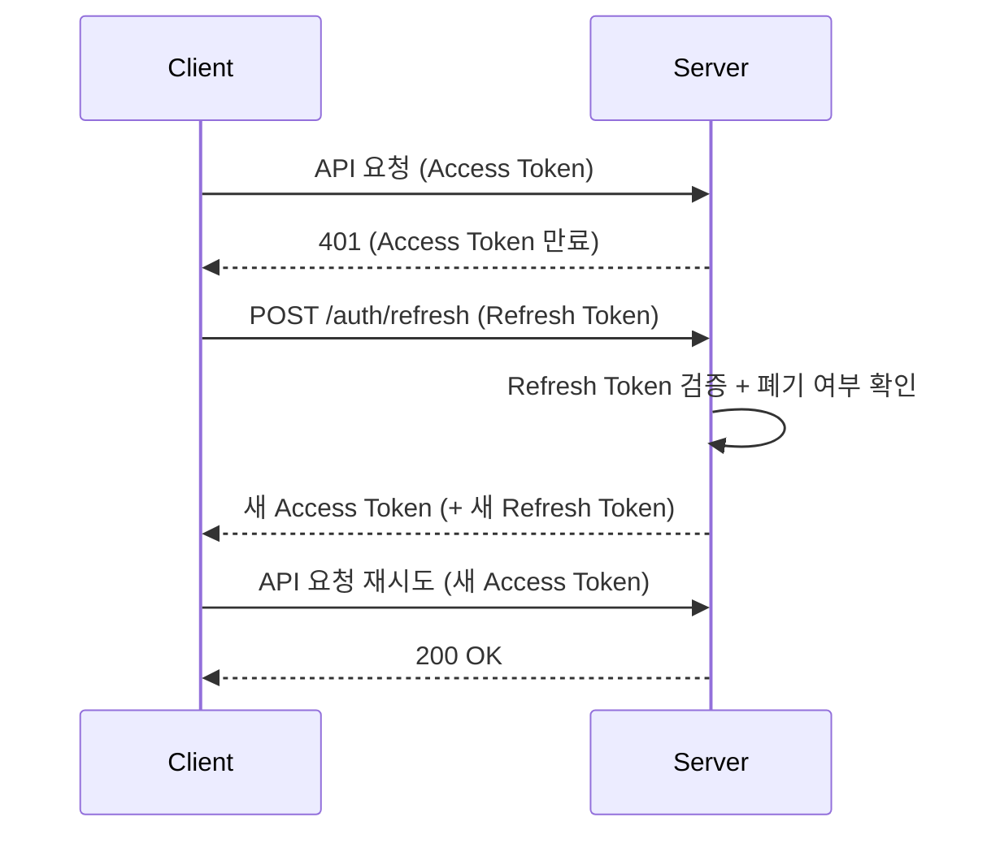
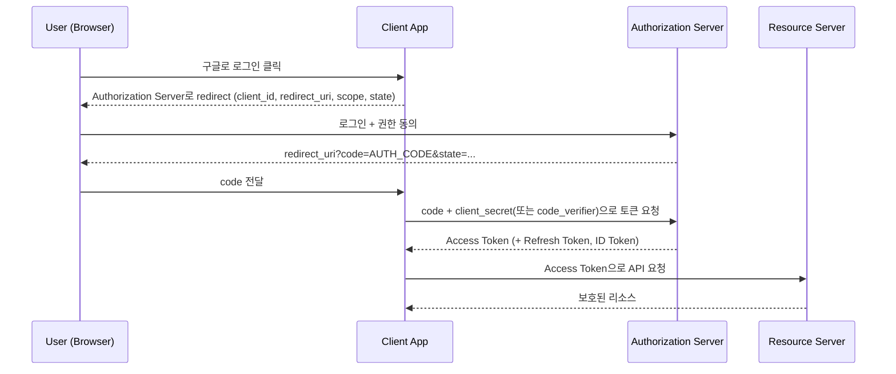
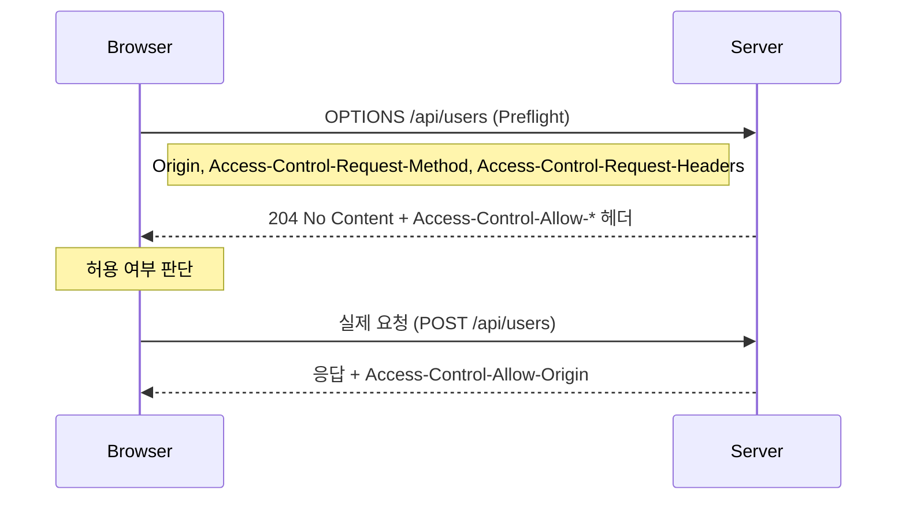
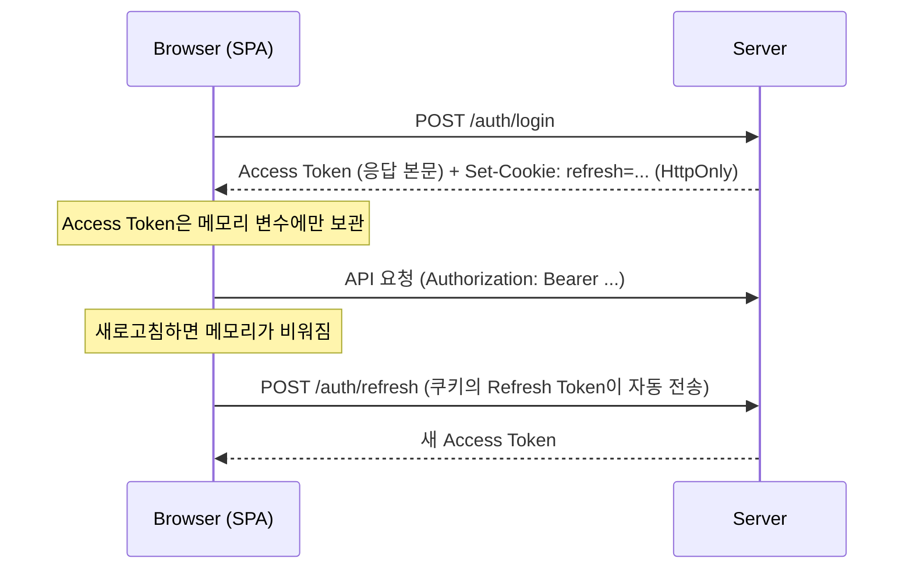
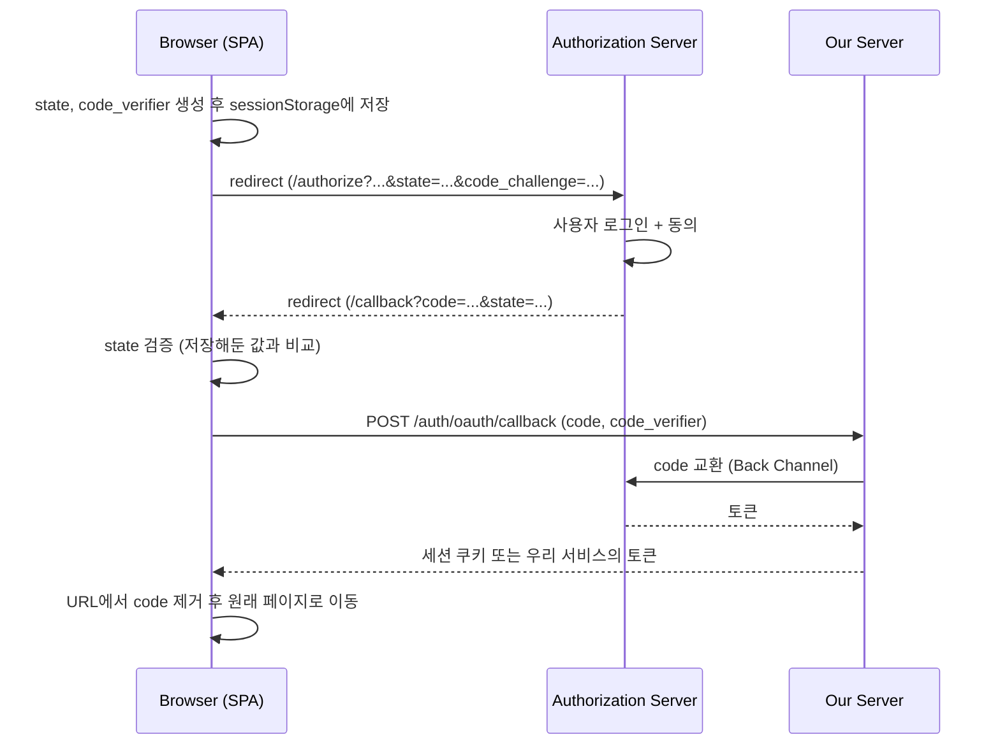

# [Week 7] 7주차 Web Security / 인증 정리

## 목차

1. [SOP](#1-sop)
2. [CORS](#2-cors)
3. [XSS](#3-xss)
4. [CSRF](#4-csrf)
5. [인증/인가](#5-인증인가)
6. [Cookie/Session](#6-cookiesession)
7. [JWT](#7-jwt)
8. [OAuth](#8-oauth)
9. [Preflight](#9-preflight)
10. [Cookie 옵션](#10-cookie-옵션)
11. [Token 저장 방식](#11-token-저장-방식)
12. [OAuth Redirect](#12-oauth-redirect)
13. [정리](#13-정리)

---

## 1. SOP

### 개념

- **SOP(Same-Origin Policy)**: 한 출처(Origin)에서 로드된 문서나 스크립트가 **다른 출처의 리소스에 접근하는 것을 제한하는** 브라우저의 기본 보안 정책
- 브라우저가 강제하는 정책이라 서버 간 통신, curl, Postman에는 적용되지 않음
- 웹 보안의 가장 밑바탕이 되는 규칙이고, CORS/XSS/CSRF 모두 이 정책을 기준으로 이해해야 함

### Origin의 구성

- **Origin = scheme(프로토콜) + host(도메인) + port**
- 셋 중 하나라도 다르면 다른 출처

```
https://example.com:443/users?id=1
└─┬──┘   └────┬────┘└┬┘
scheme      host    port        → Origin = https://example.com:443
```

| 비교 대상 (기준: https://example.com) | 같은 출처? | 이유 |
|---|---|---|
| https://example.com/other/page | 같음 | path는 출처에 포함되지 않음 |
| https://example.com:443 | 같음 | https의 기본 포트가 443 |
| http://example.com | 다름 | scheme이 다름 |
| https://api.example.com | 다름 | host가 다름 (서브도메인 포함) |
| https://example.com:8080 | 다름 | port가 다름 |

### 왜 필요한가

- 사용자가 은행 사이트에 로그인한 상태에서 악성 사이트에 접속했다고 가정
- 브라우저는 은행 도메인으로 가는 요청에 쿠키를 자동으로 붙이기 때문에, SOP가 없다면 악성 사이트의 스크립트가 **로그인된 상태로 은행 데이터를 읽어갈 수 있음**

```
 evil.com 의 스크립트
        │  fetch('https://bank.com/account')   ← 쿠키가 자동으로 붙어서 전송됨
        ▼
    bank.com ──► 응답 (계좌 정보)
        │
        ▼
 브라우저가 SOP에 따라 evil.com 스크립트에 응답을 넘겨주지 않음 ✕
```

### 무엇을 막고 무엇은 허용하는가

| 동작 | cross-origin에서 |
|---|---|
| ``, `<script>`, `<link>`, `<form>` 등 태그로 리소스 요청 | 허용 (요청 전송 가능) |
| `fetch`/`XHR` 요청 전송 | 전송은 되지만 **응답을 읽는 것은 차단** (CORS로 허용된 경우만 가능) |
| 다른 출처 iframe의 DOM 접근 | 차단 |
| localStorage, IndexedDB | 출처별로 분리되어 접근 불가 |

- 핵심: SOP는 **"요청을 막는 정책"이 아니라 "응답을 읽는 것을 막는 정책"**
- 그래서 요청 자체는 전송되는 점을 악용하는 공격이 CSRF임 (4장)

### Same-Origin vs Same-Site

| | Same-Origin | Same-Site |
|---|---|---|
| 기준 | scheme + host + port | scheme + 등록 가능한 도메인(eTLD+1) |
| `https://app.example.com` vs `https://api.example.com` | 다름 | 같음 |
| 사용처 | SOP, CORS | SameSite 쿠키 (10장) |

---

## 2. CORS

### 개념

- **CORS(Cross-Origin Resource Sharing)**: SOP를 완화해서, **서버가 응답 헤더로 "이 출처는 내 응답을 읽어도 된다"고 허용하는** 메커니즘
- 허용 여부를 판단하는 주체는 **브라우저이고**, 서버는 헤더로 의사를 표시할 뿐임



- 허용 헤더가 없거나 출처가 다르면, 브라우저는 응답을 받아 놓고도 **JS에 넘기지 않고 CORS 에러를** 냄

### 관련 헤더

| 헤더 | 방향 | 역할 |
|---|---|---|
| Origin | 요청 | 요청을 보낸 출처 (브라우저가 자동으로 추가) |
| Access-Control-Allow-Origin | 응답 | 허용하는 출처 (`*` 또는 특정 출처 하나) |
| Access-Control-Allow-Methods | 응답 | 허용하는 HTTP 메서드 (Preflight 응답) |
| Access-Control-Allow-Headers | 응답 | 허용하는 요청 헤더 (Preflight 응답) |
| Access-Control-Allow-Credentials | 응답 | 쿠키/인증 정보를 포함한 요청 허용 여부 |
| Access-Control-Expose-Headers | 응답 | JS에서 읽을 수 있게 노출할 응답 헤더 |
| Access-Control-Max-Age | 응답 | Preflight 결과를 캐싱할 시간(초) |

### 쿠키를 포함하는 요청 (Credentials)

- 다른 출처로 쿠키를 보내려면 **양쪽 모두** 명시해야 함
- 서버가 `Allow-Credentials: true`를 쓰면 `Allow-Origin`에 **`*`를 쓸 수 없고** 구체적인 출처를 지정해야 함

```js
// 클라이언트
await fetch('https://api.example.com/me', { credentials: 'include' });
```

```http
# 서버 응답
Access-Control-Allow-Origin: https://app.example.com
Access-Control-Allow-Credentials: true
Vary: Origin
```

### 흔한 오해

| 오해 | 실제로는 |
|---|---|
| CORS 에러는 서버가 요청을 거부한 것이다 | 서버는 요청을 정상 처리했을 수 있고, **브라우저가 응답을 막은 것** |
| CORS는 서버를 보호하는 보안 기능이다 | 사용자의 브라우저를 보호하는 정책. curl이나 서버에서 보내는 요청은 막지 못함 |
| `Allow-Origin: *`이면 어디서든 다 된다 | 쿠키/인증 정보를 포함한 요청에는 `*`를 쓸 수 없음 |
| CORS 에러는 프론트에서 고칠 수 있다 | 허용 헤더는 서버가 내려줘야 함. 프론트는 프록시로 우회하는 정도 |

### 서버 설정 (Express)

```js
const cors = require('cors');

app.use(cors({
  origin: ['https://app.example.com', 'https://admin.example.com'], // 허용할 출처 목록
  credentials: true,
  methods: ['GET', 'POST', 'PUT', 'PATCH', 'DELETE'],
  allowedHeaders: ['Content-Type', 'Authorization'],
}));
```

```js
// 직접 구현 시: 요청 Origin을 화이트리스트와 비교한 뒤에만 반영
const allowed = new Set(['https://app.example.com']);

app.use((req, res, next) => {
  const origin = req.headers.origin;
  if (allowed.has(origin)) {
    res.set('Access-Control-Allow-Origin', origin);
    res.set('Access-Control-Allow-Credentials', 'true');
    res.set('Vary', 'Origin'); // 출처마다 응답이 달라지므로 캐시가 구분하도록
  }
  next();
});
```

- 요청의 Origin을 **검증 없이 그대로 응답에 반영하면서** `Allow-Credentials: true`를 함께 쓰면, 모든 사이트에 로그인 세션 접근을 허용하는 것과 같아져서 매우 위험함

### 개발 환경에서의 해결: 프록시

- 개발 서버가 `/api` 요청을 백엔드로 대신 전달하면, 브라우저 입장에서는 **같은 출처로 요청하는** 것이 되어 CORS가 발생하지 않음

```js
// vite.config.js
export default {
  server: {
    proxy: { '/api': 'http://localhost:8080' },
  },
};
```

---

## 3. XSS

### 개념

- **XSS(Cross-Site Scripting)**: 공격자가 삽입한 **악성 스크립트가 피해자의 브라우저에서 해당 사이트의 출처로 실행되는** 취약점
- 스크립트가 해당 사이트와 같은 출처로 실행되기 때문에 SOP의 보호를 받지 못하고, **쿠키, 토큰, DOM, 사용자 대신 보내는 요청까지** 모두 접근 가능

### 유형

| 유형 | 설명 | 예시 |
|---|---|---|
| Stored XSS | 악성 스크립트가 서버(DB)에 저장되고, 해당 데이터를 보는 모든 사용자에게 실행 | 게시글/댓글에 스크립트 삽입 |
| Reflected XSS | 요청의 값(쿼리 스트링 등)이 응답에 그대로 반영되어 실행. 공격자가 만든 링크를 피해자가 클릭해야 함 | 검색 결과 페이지에 검색어를 그대로 출력 |
| DOM-based XSS | 서버를 거치지 않고, 클라이언트 JS가 위험한 값을 DOM에 삽입하면서 발생 | `location.hash` 값을 `innerHTML`에 삽입 |

### Stored XSS 공격 흐름



### 취약한 코드 예시

```js
// 취약: 사용자 입력을 HTML로 해석해서 삽입
comment.innerHTML = userInput;
// userInput = ''
// 이미지 로딩에 실패하면서 onerror의 스크립트가 실행됨
```

### 방어 방법

**1) 출력 시 이스케이프 (가장 기본)**

- 사용자 입력을 HTML에 넣을 때 특수문자를 엔티티로 변환해서 "코드"가 아니라 "텍스트"로 취급되게 함

```js
// 텍스트로 삽입하면 브라우저가 HTML로 해석하지 않음
comment.textContent = userInput;
```

- React, Vue 같은 프레임워크는 `{value}` 형태의 렌더링을 **기본적으로 이스케이프해줌**. 취약점은 주로 `dangerouslySetInnerHTML`, `v-html`, `href`에 사용자 입력을 넣을 때 생김

**2) HTML을 허용해야 할 때: Sanitize**

- 리치 텍스트 에디터처럼 HTML이 필요하면, 허용된 태그/속성만 남기고 나머지를 제거

```js
import DOMPurify from 'dompurify';

const clean = DOMPurify.sanitize(userHtml);
element.innerHTML = clean;
```

**3) CSP(Content Security Policy)**

- 브라우저에게 "어떤 출처의 스크립트만 실행할 수 있는지"를 알려주는 응답 헤더. XSS가 삽입되더라도 실행 자체를 막는 **2차 방어선**

```http
Content-Security-Policy: default-src 'self'; script-src 'self' https://cdn.example.com; object-src 'none'
```

| 지시자 | 의미 |
|---|---|
| default-src | 다른 지시자가 없는 리소스의 기본 허용 출처 |
| script-src | 스크립트를 로드/실행할 수 있는 출처 |
| object-src | 플러그인(`<object>`, `<embed>`) 출처 |
| frame-ancestors | 이 페이지를 iframe으로 삽입할 수 있는 출처 (클릭재킹 방어) |

- 인라인 스크립트(`<script>...</script>`)는 기본적으로 차단됨. 허용이 필요하면 요청마다 **nonce를** 발급해서 해당 스크립트에만 붙이는 방식을 사용

**4) 쿠키는 HttpOnly로**

- 스크립트에서 `document.cookie`로 쿠키를 읽지 못하게 해서 **세션 쿠키 탈취를 막음** (10장)
- 단, XSS 자체를 막는 것은 아니고, 스크립트가 사용자 대신 요청을 보내는 것은 여전히 가능

---

## 4. CSRF

### 개념

- **CSRF(Cross-Site Request Forgery)**: 로그인된 사용자의 브라우저가 **쿠키를 자동으로 첨부하는 점을 악용해서**, 사용자가 의도하지 않은 요청을 신뢰하는 사이트로 보내게 만드는 공격
- 공격자는 응답을 읽을 필요가 없고, **상태를 변경하는 요청(송금, 비밀번호 변경, 삭제)만 보내면 목적을 달성함**

### 공격 흐름



```html
<!-- evil.com 의 페이지 -->
<form action="https://bank.example.com/transfer" method="POST">
  <input name="to" value="attacker">
  <input name="amount" value="1000000">
</form>
<script>document.forms[0].submit();</script>
```

### 성립 조건

- 인증이 **쿠키(자동 전송)** 기반임
- 서버가 요청이 **어디서 시작됐는지 검증하지 않음**
- 공격자가 요청 파라미터를 **미리 알 수 있음** (예측 가능한 값만 사용)

### 왜 SOP로 막히지 않는가

- SOP는 응답을 읽는 것을 막을 뿐, **요청 전송은 막지 않음** (1장)
- 공격자는 응답을 볼 필요가 없으므로 SOP가 있어도 공격이 성립함

### 방어 방법

| 방법 | 설명 |
|---|---|
| SameSite 쿠키 | 다른 사이트에서 시작된 요청에는 쿠키를 보내지 않음 (10장). 현재 가장 기본적인 방어 |
| CSRF 토큰 | 서버가 발급한 예측 불가능한 값을 요청에 함께 보내고 서버가 검증 |
| Origin/Referer 검증 | 요청 헤더의 출처가 허용된 사이트인지 서버가 확인 |
| 커스텀 헤더 요구 | `X-Requested-With` 같은 헤더를 요구. 헤더가 붙으면 cross-origin 요청은 Preflight를 거쳐야 해서 단순 form 제출로는 보낼 수 없음 |
| 상태 변경에 GET 사용 금지 | 링크, 이미지 태그로도 유발될 수 있기 때문 (5주차의 안전한 메서드 원칙) |
| 재인증 | 비밀번호 변경, 송금 같은 민감 작업은 비밀번호/OTP를 다시 요구 |

### CSRF 토큰 동작

```js
// 서버: 세션에 토큰을 저장하고, 상태 변경 요청에서 헤더 값과 비교
app.post('/transfer', (req, res) => {
  if (req.get('X-CSRF-Token') !== req.session.csrfToken) {
    return res.status(403).json({ message: 'invalid csrf token' });
  }
  // ... 송금 처리
});
```

```js
// 클라이언트: 토큰을 헤더에 담아서 전송
await fetch('/transfer', {
  method: 'POST',
  credentials: 'include',
  headers: { 'Content-Type': 'application/json', 'X-CSRF-Token': csrfToken },
  body: JSON.stringify({ to: 'friend', amount: 1000 }),
});
```

- 악성 사이트는 쿠키를 자동으로 붙이게 할 수는 있어도, **다른 출처에 있는 토큰 값을 읽을 수는 없음** (SOP) → 토큰이 없는 요청은 거부됨

---

## 5. 인증/인가

### 개념

| | 인증 (Authentication) | 인가 (Authorization) |
|---|---|---|
| 질문 | 당신은 **누구인가** | 당신은 **무엇을 할 수 있는가** |
| 목적 | 신원 확인 | 권한 확인 |
| 예시 | 로그인 (아이디/비밀번호, OTP) | 관리자만 삭제 가능, 본인 글만 수정 가능 |
| 실패 시 응답 | 401 Unauthorized | 403 Forbidden |

```
요청 ──► 인증 (누구인가?) ──► 인가 (이 작업을 해도 되는가?) ──► 처리
              │ 실패                   │ 실패
              ▼                        ▼
            401                      403
```

### 비밀번호 저장

- 평문으로 저장하면 DB 유출 시 모든 계정이 그대로 노출됨
- **해시로** 저장하되, 속도가 빠른 해시(SHA-256 등)는 무차별 대입에 취약하므로 **의도적으로 느린 해시(bcrypt, argon2)와** **salt(사용자마다 다른 무작위 값)를** 사용

```js
import bcrypt from 'bcrypt';

const hash = await bcrypt.hash(password, 12);        // salt가 자동으로 포함되고, 12는 연산 비용
const ok = await bcrypt.compare(inputPassword, hash); // 로그인 시 비교
```

### 인가는 반드시 서버에서

- 프론트엔드에서 버튼을 숨기거나 라우트를 막는 것은 **UX를 위한 것일 뿐 보안이 아님** (사용자가 API를 직접 호출할 수 있음)
- 가장 흔한 취약점이 **IDOR(Insecure Direct Object Reference)**: URL의 id만 바꿔서 남의 데이터에 접근하는 경우

```js
app.get('/orders/:id', authenticate, async (req, res) => {
  const order = await db.orders.findById(req.params.id);

  if (!order) return res.status(404).end();
  if (order.userId !== req.user.id) {            // 소유자 검사가 없으면 id만 바꿔서 남의 주문 조회 가능
    return res.status(403).end();
  }
  res.json(order);
});
```

---

## 6. Cookie/Session

### Cookie

- 서버가 `Set-Cookie` 헤더로 브라우저에 **저장을 지시하면**, 브라우저는 이후 같은 도메인으로 가는 요청에 `Cookie` 헤더로 **자동으로 포함해서** 보냄
- HTTP가 Stateless(5주차)인 점을 보완해서 상태를 이어가는 대표적인 방법

```http
# 서버 응답
Set-Cookie: sid=abc123; Path=/; HttpOnly; Secure; SameSite=Lax; Max-Age=1800

# 이후 같은 도메인의 모든 요청
Cookie: sid=abc123
```

- 용량 제한이 작음 (쿠키 하나당 약 4KB)
- 요청마다 자동 전송되므로 큰 데이터를 담으면 모든 요청이 무거워짐

### Session

- 사용자 상태(로그인 정보 등)를 **서버에 저장하고**, 클라이언트에는 그 상태를 찾기 위한 **세션 ID만** 쿠키로 보관하는 방식



### 세션 저장소

| 저장소 | 특징 |
|---|---|
| 서버 메모리 | 구현이 간단하지만 서버 재시작 시 소실, 서버가 여러 대면 공유 불가 |
| DB | 영속적이지만 매 요청마다 조회해서 느림 |
| Redis | 빠르고, TTL로 만료 관리가 쉬워서 가장 많이 사용 |

- 서버가 여러 대일 때: 같은 사용자를 같은 서버로 보내는 Sticky Session 방식, 또는 **중앙 저장소(Redis)를** 공유하는 방식

### 세션 보안 주의점

- **세션 고정(Session Fixation)**: 공격자가 알고 있는 세션 ID를 피해자가 사용하게 만들고, 피해자가 로그인한 뒤 그 ID로 접근하는 공격 → **로그인 성공 시 세션 ID를 반드시 재발급**
- 만료 정책: 일정 시간 활동이 없으면 만료(Idle Timeout), 총 유지 시간 제한(Absolute Timeout)
- 로그아웃 시 **서버의 세션 저장소에서 삭제** (쿠키만 지우면 세션 ID를 알고 있는 사람은 계속 사용 가능)

```js
import session from 'express-session';
import RedisStore from 'connect-redis';

app.use(session({
  store: new RedisStore({ client: redisClient }),
  secret: process.env.SESSION_SECRET,
  resave: false,
  saveUninitialized: false,
  cookie: { httpOnly: true, secure: true, sameSite: 'lax', maxAge: 30 * 60 * 1000 },
}));

app.post('/login', async (req, res) => {
  const user = await verifyUser(req.body);
  req.session.regenerate(() => {          // 세션 고정 방지: 로그인 시 새 세션 ID 발급
    req.session.userId = user.id;
    res.json({ ok: true });
  });
});

app.post('/logout', (req, res) => {
  req.session.destroy(() => {             // 서버 저장소에서 삭제
    res.clearCookie('connect.sid');
    res.json({ ok: true });
  });
});
```

---

## 7. JWT

### 개념

- **JWT(JSON Web Token)**: 사용자 정보(클레임)를 JSON으로 담고 **서명을 붙인 토큰**
- 서버는 세션 저장소를 조회하지 않고 **서명만 검증해서** 신원을 확인함 (Stateless)

### 구조

- 점(`.`)으로 구분된 세 부분을 각각 Base64URL로 인코딩한 문자열

```
eyJhbGciOiJIUzI1NiJ9 . eyJzdWIiOiIxIiwiZXhwIjoxNzAwMDAwMDAwfQ . SflKxwRJSMeKKF2QT4fwpM
      Header                         Payload                           Signature
```

```json
// Header: 서명 알고리즘, 토큰 타입
{ "alg": "HS256", "typ": "JWT" }

// Payload: 클레임(담고 싶은 정보)
{ "sub": "1", "role": "user", "iat": 1700000000, "exp": 1700000900 }
```

```
Signature = HMAC_SHA256( base64url(Header) + "." + base64url(Payload), 서버만 아는 비밀키 )
```

- **Payload는 암호화가 아니라 단순 인코딩이라** 누구나 디코딩해서 읽을 수 있음 → 비밀번호 같은 **민감 정보를 넣으면 안 됨**
- 서명이 보장하는 것은 **위변조 방지(무결성)이지** 기밀성이 아님

### 검증할 때 확인할 것

1. 서명이 유효한가
2. 만료(`exp`)되지 않았는가
3. 발급자(`iss`), 대상(`aud`)이 기대한 값인가
4. 알고리즘을 **서버가 지정한 것만 허용하는가** (토큰 헤더의 `alg` 값을 그대로 믿으면 `none` 알고리즘 공격 등에 노출됨)

```js
import jwt from 'jsonwebtoken';

// 발급
const token = jwt.sign(
  { sub: user.id, role: user.role },
  process.env.JWT_SECRET,
  { expiresIn: '15m', issuer: 'api.example.com' }
);

// 검증: 알고리즘과 발급자를 명시
try {
  const payload = jwt.verify(token, process.env.JWT_SECRET, {
    algorithms: ['HS256'],
    issuer: 'api.example.com',
  });
} catch (e) {
  // TokenExpiredError, JsonWebTokenError 등
}
```

### Access Token과 Refresh Token

- JWT는 **한 번 발급하면 만료 전에 서버가 무효화하기 어려움** (서버가 상태를 저장하지 않기 때문)
- 그래서 **수명이 짧은 Access Token + 수명이 긴 Refresh Token** 조합을 사용

| | Access Token | Refresh Token |
|---|---|---|
| 용도 | API 요청 인증 | Access Token 재발급 |
| 수명 | 짧음 (5~15분) | 긺 (수일~수주) |
| 전송 | 모든 API 요청 | 재발급 요청에만 |
| 서버 저장 | 보통 안 함 | 저장해서 폐기 가능하게 관리 |



- **Refresh Token Rotation**: 재발급할 때마다 Refresh Token도 새로 발급하고 이전 것은 폐기 → 탈취된 토큰이 재사용되면 감지 가능

---

## 8. OAuth

### 개념

- **OAuth 2.0**: 사용자의 **비밀번호를 제3자 앱에 넘기지 않고**, 제한된 권한(scope)만 위임해서 리소스에 접근하게 해주는 **인가(Authorization) 프레임워크**
- 예: "구글 계정으로 로그인", 외부 앱이 내 GitHub 저장소 목록을 읽도록 허용
- OAuth 자체는 **"무엇을 할 수 있는가"를 위임하는** 규격이고, **"누구인가"를 확인하는 인증은 OIDC(OpenID Connect)가** 그 위에 추가함

### 4가지 역할

| 역할 | 설명 | 예시 |
|---|---|---|
| Resource Owner | 리소스의 주인 | 사용자 |
| Client | 리소스에 접근하려는 애플리케이션 | 우리 서비스 |
| Authorization Server | 사용자를 인증하고 토큰을 발급 | 구글 계정 서버 |
| Resource Server | 보호된 리소스를 가진 API 서버 | 구글 API |

### Authorization Code Flow



### 왜 바로 토큰을 주지 않고 code를 거칠까

- 브라우저를 거치는 구간(Front Channel)은 URL이 기록에 남고 노출되기 쉬움
- 그래서 브라우저에는 **일회용 code만** 전달하고, 실제 토큰은 **서버 간 직접 통신(Back Channel)으로** 교환해서 토큰이 브라우저 주소창에 노출되지 않게 함

### 주요 파라미터

| 파라미터 | 역할 |
|---|---|
| client_id | 서비스를 식별하는 값 |
| redirect_uri | 인증 후 돌아올 주소 (사전에 등록한 값과 정확히 일치해야 함) |
| scope | 요청하는 권한 범위 (예: `profile email`) |
| state | 요청과 응답을 연결하는 무작위 값. CSRF 방지용 |
| code_challenge | PKCE에서 `code_verifier`의 해시값 |

### PKCE (Proof Key for Code Exchange)

- SPA나 모바일 앱은 `client_secret`을 안전하게 숨길 수 없음 (Public Client)
- 요청마다 무작위 `code_verifier`를 만들고 그 해시(`code_challenge`)를 인증 요청에 함께 보냄 → 토큰 교환 시 원본 `code_verifier`를 제시해야 하므로, **code를 중간에 가로채도 토큰을 얻을 수 없음**

### OAuth vs OIDC

| | OAuth 2.0 | OIDC |
|---|---|---|
| 목적 | 권한 위임 (인가) | 사용자 신원 확인 (인증) |
| 결과물 | Access Token | Access Token + **ID Token (JWT)** |
| scope | 서비스별 정의 | `openid`를 포함 |
| 질문 | 이 앱이 내 리소스에 접근해도 되는가 | 이 사용자는 누구인가 |

- **Access Token은 API 호출용, ID Token은 로그인한 사용자가 누구인지 알려주는 용도이므로** 혼동하지 않아야 함

```js
// 인증 요청 URL 생성
const params = new URLSearchParams({
  response_type: 'code',
  client_id: CLIENT_ID,
  redirect_uri: 'https://app.example.com/callback',
  scope: 'openid profile email',
  state,
  code_challenge: challenge,
  code_challenge_method: 'S256',
});

location.assign(`https://auth.example.com/authorize?${params}`);
```

---

# Frontend 심화

## 9. Preflight

### 개념

- 특정 cross-origin 요청을 보내기 전에, 브라우저가 **자동으로 `OPTIONS` 요청을 먼저 보내서 서버가 실제 요청을 허용하는지 확인하는** 절차
- 개발자가 코드로 보내는 요청이 아니라, `fetch`를 호출하면 **브라우저가 알아서 끼워 넣는** 요청

### 왜 필요한가

- CORS 이전에도 `<form>`으로 cross-origin GET/POST 전송은 가능했기 때문에, 이런 요청은 서버가 CORS를 몰라도 이미 있을 수 있는 요청임
- 반면 PUT/DELETE, JSON 본문, 커스텀 헤더 같은 요청은 **CORS를 이해하지 못하는 서버에 보내면 의도치 않게 데이터가 변경될 수 있음**
- 그래서 먼저 "이런 요청을 보내도 되나요?"를 물어보고, 허용될 때만 실제 요청을 보냄

### Preflight가 발생하는 조건

- 아래 **Simple Request 조건을 모두 만족하면 Preflight 없이** 바로 요청을 보냄

| 항목 | Simple Request 조건 |
|---|---|
| 메서드 | GET, HEAD, POST 중 하나 |
| 헤더 | 브라우저가 기본으로 붙이는 헤더 외에는 `Accept`, `Accept-Language`, `Content-Language`, `Content-Type`만 허용 |
| Content-Type | `application/x-www-form-urlencoded`, `multipart/form-data`, `text/plain` 중 하나 |

- 따라서 **다음 중 하나라도 해당하면 Preflight가 발생함**

| 상황 | 예시 |
|---|---|
| Content-Type이 JSON | `Content-Type: application/json` (가장 흔한 원인) |
| 인증/커스텀 헤더 사용 | `Authorization`, `X-CSRF-Token`, `X-Requested-With` |
| PUT, PATCH, DELETE 메서드 | `method: 'DELETE'` |

### 동작 흐름



```http
# (1) 브라우저가 자동으로 보내는 Preflight 요청
OPTIONS /api/users HTTP/1.1
Origin: https://app.example.com
Access-Control-Request-Method: POST
Access-Control-Request-Headers: content-type, authorization

# (2) 서버의 Preflight 응답
HTTP/1.1 204 No Content
Access-Control-Allow-Origin: https://app.example.com
Access-Control-Allow-Methods: GET, POST, PUT, PATCH, DELETE
Access-Control-Allow-Headers: Content-Type, Authorization
Access-Control-Allow-Credentials: true
Access-Control-Max-Age: 600
```

### Preflight 캐싱

- `Access-Control-Max-Age`(초)를 지정하면 브라우저가 그 시간 동안 같은 요청에 대한 Preflight 결과를 **캐싱해서** 매번 `OPTIONS`를 보내지 않음
- 브라우저마다 상한이 있음 (예: Chrome은 최대 2시간)
- 지정하지 않으면 짧은 기본값이 적용되어 요청이 많을 때 **네트워크 요청이 두 배로** 늘어날 수 있음

### 서버 구현 시 주의점

- Preflight 요청은 **쿠키와 `Authorization` 헤더가 붙지 않은 채로** 전송됨
  → 인증 미들웨어보다 **먼저** `OPTIONS` 요청을 처리해야 하고, 그렇지 않으면 `401`이 반환되어 Preflight가 실패함
- 응답 상태 코드는 `2xx`(보통 204)여야 하고, **리다이렉트(3xx)는 허용되지 않음**
- 인증이 필요한 요청이면 `Allow-Credentials: true`와 구체적인 `Allow-Origin`이 필요함

```js
// 인증 미들웨어보다 앞에 위치해야 함
app.options('/api/*', (req, res) => {
  res.set({
    'Access-Control-Allow-Origin': 'https://app.example.com',
    'Access-Control-Allow-Methods': 'GET,POST,PUT,PATCH,DELETE',
    'Access-Control-Allow-Headers': 'Content-Type, Authorization',
    'Access-Control-Allow-Credentials': 'true',
    'Access-Control-Max-Age': '600',
    Vary: 'Origin',
  });
  res.sendStatus(204);
});

app.use('/api', authenticate); // 인증은 OPTIONS 처리 이후
```

### 자주 만나는 에러

| 에러 메시지 (요약) | 원인 | 해결 |
|---|---|---|
| No 'Access-Control-Allow-Origin' header is present | 서버 CORS 설정 없음, 또는 OPTIONS 요청 미처리 | 서버에 CORS 설정 추가, OPTIONS 라우트 처리 |
| Request header field authorization is not allowed | `Allow-Headers`에 해당 헤더가 없음 | `Allow-Headers`에 추가 |
| Method PUT is not allowed | `Allow-Methods`에 해당 메서드가 없음 | `Allow-Methods`에 추가 |
| wildcard '*' cannot be used when credentials mode is 'include' | credentials 요청인데 `Allow-Origin: *` | 구체적인 출처로 지정 |
| Response to preflight request doesn't pass access control check: redirect / 401 | Preflight가 리다이렉트되거나 인증 때문에 실패 | OPTIONS는 인증/리다이렉트 이전에 처리 |

---

## 10. Cookie 옵션

### 속성 한눈에 보기

```http
Set-Cookie: sid=abc123; Domain=example.com; Path=/; Max-Age=1800; Secure; HttpOnly; SameSite=Lax
```

| 속성 | 역할 |
|---|---|
| Domain | 쿠키를 전송할 도메인 범위 (지정하면 서브도메인에도 전송) |
| Path | 쿠키를 전송할 경로 범위 |
| Max-Age / Expires | 쿠키의 수명 (미지정 시 브라우저를 닫으면 삭제되는 세션 쿠키) |
| Secure | HTTPS 연결에서만 전송 |
| HttpOnly | JS(`document.cookie`)에서 접근 불가 |
| SameSite | 다른 사이트에서 시작된 요청에 쿠키를 보낼지 결정 |

### HttpOnly

- `document.cookie`로 읽을 수 없어서 **XSS로 세션 쿠키가 탈취되는 것을 막음**
- 쿠키 자체는 요청에 계속 첨부되므로, XSS로 사용자 대신 요청을 보내는 공격까지는 막지 못함

```js
document.cookie; // HttpOnly 쿠키는 이 값에 나타나지 않음
```

### Secure

- HTTPS가 아닌 연결로는 쿠키를 전송하지 않아서 **네트워크 도청으로 쿠키가 노출되는 것을 방지**
- 로컬 개발(`localhost`)에서는 예외적으로 동작하는 경우가 있음

### SameSite

- 요청이 **다른 사이트에서 시작된 경우** 쿠키를 보낼지 여부를 정함 → CSRF 방어의 핵심

| 요청 상황 | Strict | Lax | None |
|---|---|---|---|
| 같은 사이트 내부 요청 | 전송 | 전송 | 전송 |
| 다른 사이트에서 링크 클릭으로 이동 (GET 이동) | 미전송 | 전송 | 전송 |
| 다른 사이트의 form POST | 미전송 | 미전송 | 전송 |
| 다른 사이트의 `fetch`, ``, `<iframe>` | 미전송 | 미전송 | 전송 |

| 값 | 특징 |
|---|---|
| Strict | 가장 엄격함. 외부 링크로 들어와도 처음에는 로그인이 풀린 것처럼 보일 수 있음 |
| Lax | 안전한 메서드(GET)의 최상위 이동만 허용. **대부분의 브라우저 기본값** |
| None | 항상 전송. 반드시 `Secure`와 함께 써야 함 |

- 값을 지정하지 않으면 현재 주요 브라우저는 `Lax`로 취급함
- **Same-Site 기준**(1장)이므로 `app.example.com`과 `api.example.com` 사이의 요청은 same-site라서 `Lax`/`Strict`에서도 쿠키가 전송됨

### Domain과 Path

- **Domain 미지정**: 쿠키를 설정한 호스트에만 전송 (host-only, 서브도메인에는 전송되지 않음)
- **Domain 지정**: 해당 도메인과 모든 서브도메인에 전송 → 서브도메인 중 하나가 취약하면 영향을 받을 수 있음
- **Path**: 특정 경로에서만 쿠키를 전송. 다만 같은 출처의 JS는 다른 경로의 쿠키도 접근할 수 있어서 **보안 경계는 아님**

### 권장 조합

| 용도 | 권장 설정 |
|---|---|
| 세션 쿠키 | `HttpOnly; Secure; SameSite=Lax; Path=/` |
| Refresh Token 쿠키 | `HttpOnly; Secure; SameSite=Strict; Path=/auth/refresh` (재발급 요청에만 전송) |
| 외부 사이트에 삽입되는 서비스 (결제창 등) | `Secure; SameSite=None` (+ CSRF 대응 별도 필요) |

### 프론트/백엔드가 분리된 구조에서

- 프론트(`app.example.com`)와 백엔드(`api.example.com`)가 **같은 사이트(example.com)라면** `SameSite=Lax`로도 쿠키가 전송되고 CORS 설정만 맞추면 됨
- 서로 **완전히 다른 도메인**(예: `myapp.com` ↔ `api-server.io`)이면 `SameSite=None; Secure`가 필요하고, 브라우저의 **서드파티 쿠키 제한 정책의** 영향을 받을 수 있음
- 가능하면 **같은 상위 도메인 아래로 구성하는** 것이 안정적임

```js
// Express에서 쿠키 설정
res.cookie('sid', sessionId, {
  httpOnly: true,
  secure: true,
  sameSite: 'lax',
  maxAge: 30 * 60 * 1000,   // 밀리초 단위
  path: '/',
});

// 삭제 (설정할 때와 같은 옵션으로)
res.clearCookie('sid', { path: '/', secure: true, sameSite: 'lax' });
```

```js
// 클라이언트: cross-origin 요청에 쿠키를 포함하려면 credentials 지정 (서버는 CORS credentials 허용 필요)
await fetch('https://api.example.com/me', { credentials: 'include' });
```

---

## 11. Token 저장 방식

### 고민의 핵심

- JWT를 쓰는 SPA에서 **Access Token을 클라이언트 어디에 보관할 것인가의** 문제
- 저장 위치에 따라 XSS와 CSRF 중 **어느 쪽에 더 취약해지는지가** 달라짐

### 저장 위치별 비교

| 저장 위치 | XSS | CSRF | 새로고침 후 | 특징 |
|---|---|---|---|---|
| JS 메모리 (변수) | 토큰 값을 꺼내가기 어려움 | 안전 (자동 전송 없음) | 사라짐 | 가장 안전하지만 복구 방법 필요 |
| localStorage | 스크립트가 바로 읽어서 탈취 가능 | 안전 | 유지 | 구현이 쉽지만 XSS에 취약 |
| sessionStorage | 스크립트가 바로 읽어서 탈취 가능 | 안전 | 같은 탭에서 유지 | 탭을 닫으면 삭제 |
| HttpOnly 쿠키 | JS로 읽을 수 없음 | 취약 (자동 전송) → SameSite/CSRF 토큰 필요 | 유지 | XSS 탈취는 막고 CSRF 대응이 필요 |

- 어떤 저장소를 쓰든 **XSS가 실행되면 해당 페이지에서 API를 호출하는 것 자체는 가능함**
- 차이는 **토큰 값을 밖으로 빼가서 오랫동안 쓸 수 있느냐임** (localStorage는 그대로 가져가 공격자 환경에서 재사용 가능)

### 권장되는 조합

- **Access Token은 메모리에**, **Refresh Token은 HttpOnly 쿠키에** 두는 방식



- Access Token은 수명이 짧아서 유출되어도 피해 시간이 제한됨
- 새로고침으로 메모리가 사라져도 **Refresh Token 쿠키로 조용히 재발급(Silent Refresh)해서** 로그인 상태를 복구
- Refresh Token 쿠키는 `Path=/auth/refresh`로 제한하고 `SameSite`를 설정해서 CSRF 위험을 줄임

### BFF(Backend For Frontend) 패턴

- 브라우저에는 **토큰을 아예 주지 않고**, 프론트 전용 서버(BFF)가 토큰을 보관하며 API 호출을 대신 수행
- 브라우저는 **세션 쿠키(HttpOnly)만** 가지므로 JS로 접근 가능한 토큰이 존재하지 않음

```
Browser ──(HttpOnly 세션 쿠키)──► BFF 서버 ──(Access Token 보관·첨부)──► API 서버
```

- 구조가 한 단계 늘어나는 대신 토큰 노출 위험이 가장 낮아서, 보안 요구가 높은 서비스에서 많이 선택함

### 구현 예시: 메모리 저장 + 자동 재발급

```js
let accessToken = null;                         // 모듈 변수 (localStorage가 아님)
export const setAccessToken = (token) => { accessToken = token; };

api.interceptors.request.use((config) => {
  if (accessToken) config.headers.Authorization = `Bearer ${accessToken}`;
  return config;
});

let refreshing = null;                          // 동시에 여러 401이 와도 재발급은 한 번만

api.interceptors.response.use(
  (res) => res,
  async (error) => {
    const original = error.config;

    if (error.response?.status === 401 && !original._retry) {
      original._retry = true;                   // 무한 재시도 방지
      refreshing ??= axios
        .post('/auth/refresh', null, { withCredentials: true })
        .then((res) => setAccessToken(res.data.accessToken))
        .finally(() => { refreshing = null; });

      await refreshing;
      return api(original);                     // 새 토큰으로 원래 요청 재시도
    }
    return Promise.reject(error);
  }
);
```

---

## 12. OAuth Redirect

### 개념

- Authorization Code Flow(8장)에서 **브라우저가 인증 서버로 이동했다가 `redirect_uri`로 되돌아오는 과정을** 프론트엔드에서 구현하는 부분
- 페이지가 두 번 이동하므로 **이동 전의 상태(state, PKCE 값, 원래 페이지)를 어디에 잠깐 보관할지가** 핵심

### 프론트엔드 관점의 흐름



### 1) 로그인 시작: state와 PKCE 생성

```js
const base64url = (buf) =>
  btoa(String.fromCharCode(...new Uint8Array(buf)))
    .replace(/\+/g, '-').replace(/\//g, '_').replace(/=+$/, '');

async function startLogin() {
  const state = base64url(crypto.getRandomValues(new Uint8Array(16)));
  const verifier = base64url(crypto.getRandomValues(new Uint8Array(32)));
  const challenge = base64url(
    await crypto.subtle.digest('SHA-256', new TextEncoder().encode(verifier))
  );

  // 리다이렉트로 페이지가 바뀌어도 남아있어야 하므로 sessionStorage에 임시 저장
  sessionStorage.setItem('oauth_state', state);
  sessionStorage.setItem('pkce_verifier', verifier);
  sessionStorage.setItem('return_to', location.pathname);

  const params = new URLSearchParams({
    response_type: 'code',
    client_id: CLIENT_ID,
    redirect_uri: `${location.origin}/callback`,
    scope: 'openid profile email',
    state,
    code_challenge: challenge,
    code_challenge_method: 'S256',
  });
  location.assign(`https://auth.example.com/authorize?${params}`);
}
```

### 2) 콜백 처리

```js
async function handleCallback() {
  const params = new URLSearchParams(location.search);

  if (params.get('error')) throw new Error(params.get('error')); // 사용자가 동의를 거부한 경우 등

  // state 검증: 내가 시작한 로그인 요청에 대한 응답인지 확인
  if (params.get('state') !== sessionStorage.getItem('oauth_state')) {
    throw new Error('state mismatch');
  }

  const res = await fetch('/api/auth/oauth/callback', {
    method: 'POST',
    credentials: 'include',
    headers: { 'Content-Type': 'application/json' },
    body: JSON.stringify({
      code: params.get('code'),
      codeVerifier: sessionStorage.getItem('pkce_verifier'),
    }),
  });
  if (!res.ok) throw new Error('login failed');

  const returnTo = sessionStorage.getItem('return_to') ?? '/';
  sessionStorage.removeItem('oauth_state');
  sessionStorage.removeItem('pkce_verifier');
  sessionStorage.removeItem('return_to');

  history.replaceState(null, '', '/');   // 주소창과 기록에서 code 제거
  location.replace(returnTo.startsWith('/') ? returnTo : '/'); // 내부 경로만 허용
}
```

### state가 하는 일

- 로그인 요청을 시작할 때 만든 무작위 값을 저장해두고, 돌아온 응답의 `state`와 비교
- 공격자가 자신의 `code`를 피해자의 브라우저에 주입해서 **피해자를 공격자 계정으로 로그인시키는 공격(Login CSRF)을** 막음
- 일치하지 않으면 **즉시 중단하고** `code`를 사용하지 않음

### redirect_uri 보안

- 인증 서버에 **사전에 등록한 URI와 정확히 일치해야만** 허용하도록 설정 (와일드카드 지양)
- 느슨하게 설정하면 공격자가 자신의 주소로 `code`를 받아갈 수 있음
- 로그인 후 원래 가려던 페이지로 돌려보낼 때(`returnTo`)도 **외부 URL로의 이동을 허용하면 Open Redirect 취약점이** 되므로 내부 경로만 허용

### 자주 발생하는 문제

| 문제 | 원인 | 해결 |
|---|---|---|
| redirect_uri_mismatch | 코드의 `redirect_uri`가 인증 서버에 등록된 값과 다름 (끝의 `/`, http/https, 포트) | 등록값과 완전히 동일하게 맞춤. 로컬 개발용 주소도 별도 등록 |
| state mismatch | 로그인 도중 새 탭/시크릿 창으로 열리거나, 저장소가 비워짐 | 같은 탭에서 진행, 저장 위치 확인 |
| invalid_grant | `code`는 **일회용이고 수명이 매우 짧음**. 재사용하거나 새로고침으로 콜백을 두 번 처리 | 콜백 처리 직후 URL에서 `code` 제거, 중복 호출 방지 |
| 콜백 후 로그인이 풀림 | 쿠키의 SameSite/Domain 설정으로 쿠키가 저장되지 않음 | 10장의 쿠키 옵션 점검 |

---

## 13. 정리

| 개념 | 핵심 |
|---|---|
| SOP | 다른 출처의 응답을 읽는 것을 막는 브라우저 정책. 요청 전송은 막지 않음 |
| CORS | 서버가 응답 헤더로 특정 출처의 읽기를 허용. 판단은 브라우저가 수행 |
| XSS | 악성 스크립트가 사이트 출처로 실행됨. 이스케이프, sanitize, CSP, HttpOnly로 방어 |
| CSRF | 쿠키 자동 전송을 악용해 원치 않는 요청 유발. SameSite, CSRF 토큰으로 방어 |
| 인증/인가 | 인증은 신원 확인(401), 인가는 권한 확인(403). 인가는 반드시 서버에서 검증 |
| Cookie/Session | 상태는 서버에 저장하고 세션 ID만 쿠키로 전달. 로그인 시 세션 재발급 |
| JWT | 서명된 토큰, 서버 상태 불필요. Payload는 노출되므로 민감 정보 금지, 짧은 Access + Refresh 조합 |
| OAuth | 비밀번호 없이 권한을 위임하는 프레임워크. Authorization Code + PKCE가 표준, 인증은 OIDC |
| Preflight | JSON, 커스텀 헤더, PUT/DELETE 요청 전에 OPTIONS로 허용 여부 확인. Max-Age로 캐싱 |
| Cookie 옵션 | HttpOnly(XSS), Secure(도청), SameSite(CSRF)를 기본 조합으로 설정 |
| Token 저장 방식 | Access는 메모리, Refresh는 HttpOnly 쿠키가 일반적. 가장 안전한 구성은 BFF |
| OAuth Redirect | state와 PKCE를 sessionStorage에 임시 저장, 콜백에서 state 검증, redirect_uri 정확히 일치 |