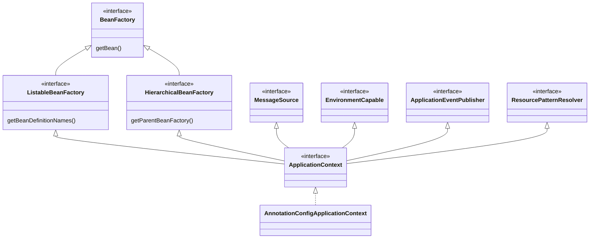

# Bean / BeanFactory / ApplicationContext

## Bean

Spring 빈은 **Spring IoC 컨테이너가 생성하고 관리하는 객체**다. `new`로 직접 만든 객체는 빈이 아니다.

### 빈 등록 방법

**컴포넌트 스캔**

```java
@Component   // @Controller, @Service, @Repository, @Configuration 모두 @Component를 포함
public class OrderService { }
```

- `@SpringBootApplication`에 포함된 `@ComponentScan`이 해당 패키지와 하위 패키지를 스캔한다.
- 빈 이름은 클래스 이름의 첫 글자를 소문자로 바꾼 것이다. (`orderService`)
- `@Repository`는 DB 예외를 Spring의 `DataAccessException`으로 바꿔주는 기능이 추가된다.

**`@Configuration` + `@Bean`**

```java
@Configuration
public class AppConfig {
    @Bean
    public PaymentClient paymentClient() {
        return new TossPayClient(apiKey());
    }

    @Bean
    public ObjectMapper objectMapper() { ... }
}
```

- 외부 라이브러리 클래스처럼 내가 `@Component`를 붙일 수 없는 객체를 등록할 때 쓴다.
- 빈 이름은 메서드 이름이다.

### `@Configuration`과 싱글톤 보장

```java
@Configuration
public class AppConfig {
    @Bean public MemberRepository memberRepository() { return new MemoryMemberRepository(); }
    @Bean public MemberService memberService() { return new MemberService(memberRepository()); }
    @Bean public OrderService orderService() { return new OrderService(memberRepository()); }
}
```

`memberRepository()`를 두 번 호출했지만 객체는 하나만 만들어진다.

- Spring이 `AppConfig`를 CGLIB으로 상속한 프록시 클래스(`AppConfig$$SpringCGLIB$$0`)를 빈으로 등록하기 때문이다.
- 프록시가 `@Bean` 메서드 호출을 가로채서 이미 컨테이너에 있으면 그 빈을 돌려준다.
- `@Configuration` 없이 `@Bean`만 쓰면(lite mode) 메서드 호출마다 새 객체가 생긴다.
- `@Configuration(proxyBeanMethods = false)`로 끌 수 있다. 스프링 부트 자동 구성 클래스는 시작 속도 때문에 대부분 끄고 쓴다.

### 빈 스코프

| 스코프 | 범위 |
| --- | --- |
| `singleton` | 기본값. 컨테이너당 하나. 컨테이너 시작부터 종료까지 유지 |
| `prototype` | 요청할 때마다 새로 생성. 생성과 주입, 초기화까지만 컨테이너가 관리 |
| `request` | HTTP 요청 하나 동안 유지 |
| `session` | HTTP 세션 동안 유지 |
| `application` | `ServletContext`와 같은 범위 |

**싱글톤 빈은 상태를 가지면 안 된다.** 여러 요청 스레드가 같은 객체를 공유하기 때문이다.

```java
@Service
public class PriceService {
    private int price;   // X: 스레드 A가 넣은 값을 스레드 B가 덮어쓸 수 있음

    public int order(int price) {
        this.price = price;
        return this.price;
    }
}
```

필드 대신 지역 변수, 파라미터, `ThreadLocal`을 쓴다.

**싱글톤 안에서 prototype 빈 쓰기**

싱글톤 빈에 prototype 빈을 주입하면 주입 시점에 한 번만 만들어진다. 매번 새 객체가 필요하면 `ObjectProvider`로 필요할 때마다 꺼낸다.

```java
@Service
public class ReportService {
    private final ObjectProvider<ReportBuilder> builderProvider;

    public Report create() {
        ReportBuilder builder = builderProvider.getObject();  // 호출할 때마다 새 prototype
        ...
    }
}
```

request 스코프 빈도 비슷한 문제가 있다. 애플리케이션 시작 시점에는 HTTP 요청이 없어서 주입할 수 없다. `ObjectProvider`를 쓰거나 `@Scope(value = "request", proxyMode = ScopedProxyMode.TARGET_CLASS)`로 가짜 프록시를 먼저 주입한다.

## BeanFactory

`BeanFactory`는 Spring IoC 컨테이너의 **최상위 인터페이스**다.

```java
public interface BeanFactory {
    Object getBean(String name);
    <T> T getBean(Class<T> requiredType);
    <T> ObjectProvider<T> getBeanProvider(Class<T> requiredType);
    boolean containsBean(String name);
    boolean isSingleton(String name);
    ...
}
```

- 빈을 생성하고 조회하고 의존관계를 연결하는 핵심 기능을 가진다.
- 대표 구현체는 `DefaultListableBeanFactory`다. `ApplicationContext`도 내부에서 이 객체에 빈 관리를 맡긴다.
- 기본적으로 **지연 로딩**이다. `getBean()`을 호출할 때 빈을 만든다.

## ApplicationContext

`ApplicationContext`는 `BeanFactory`를 상속하고 애플리케이션 개발에 필요한 기능을 더한 컨테이너다. 실무에서 "스프링 컨테이너"라고 하면 보통 이것을 말한다.

```java
public interface ApplicationContext extends EnvironmentCapable, ListableBeanFactory,
        HierarchicalBeanFactory, MessageSource, ApplicationEventPublisher, ResourcePatternResolver { }
```



| 상속한 인터페이스 | 추가 기능 |
| --- | --- |
| `MessageSource` | 국제화(i18n) 메시지 |
| `EnvironmentCapable` | profile, 프로퍼티 같은 환경 정보 (`application.yml`) |
| `ApplicationEventPublisher` | 이벤트 발행과 구독 (`@EventListener`) |
| `ResourcePatternResolver` | 클래스패스, 파일, URL 리소스 조회 |

### BeanFactory와 ApplicationContext 비교

| | BeanFactory | ApplicationContext |
| --- | --- | --- |
| 싱글톤 빈 생성 시점 | 요청 시 (지연 로딩) | 컨테이너 시작 시 (즉시 로딩) |
| `BeanPostProcessor` 등록 | 직접 등록해야 함 | 자동 감지 후 등록 |
| 부가 기능 | 없음 | 메시지, 환경, 이벤트, 리소스 |
| 사용처 | 거의 직접 쓰지 않음 | 일반적인 애플리케이션 |

**즉시 로딩의 장점**은 설정 오류를 시작할 때 바로 알 수 있다는 것이다. 의존성 누락이나 순환 참조가 있으면 첫 요청이 아니라 배포 시점에 실패한다. 특정 빈만 늦게 만들고 싶으면 `@Lazy`를 붙인다.

### 주요 구현체

- `AnnotationConfigApplicationContext`: 자바 설정 클래스 기반
- `AnnotationConfigServletWebServerApplicationContext`: Spring Boot 서블릿 웹 애플리케이션 (Spring MVC)
- `AnnotationConfigReactiveWebServerApplicationContext`: Spring Boot 리액티브 웹 애플리케이션 (WebFlux)

```java
ApplicationContext ac = new AnnotationConfigApplicationContext(AppConfig.class);
OrderService orderService = ac.getBean(OrderService.class);
```

Spring Boot에서는 `SpringApplication.run()`이 classpath를 보고 적절한 구현체를 골라 만든다.

### 컨테이너 refresh 흐름

`AbstractApplicationContext.refresh()`가 컨테이너를 띄우는 핵심 메서드다. 흐름을 간단히 보면 다음과 같다.

1. `BeanFactory` 준비
2. **`BeanFactoryPostProcessor` 실행**: 빈 정의(BeanDefinition)를 읽고 수정한다. 컴포넌트 스캔과 `@Configuration` 처리(`ConfigurationClassPostProcessor`)가 여기서 일어난다.
3. **`BeanPostProcessor` 등록**
4. 메시지 소스, 이벤트 멀티캐스터 초기화
5. `onRefresh()`: Spring Boot 웹 애플리케이션은 여기서 내장 톰캣을 만든다.
6. **싱글톤 빈 생성** (`finishBeanFactoryInitialization`)
7. `ContextRefreshedEvent` 발행
