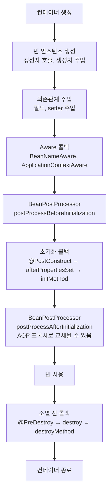

# Bean Lifecycle

## 싱글톤 빈의 생명주기

```text
컨테이너 생성
 → 빈 인스턴스 생성 (생성자 호출, 생성자 주입)
 → 의존관계 주입 (필드, setter 주입)
 → Aware 콜백
 → BeanPostProcessor.postProcessBeforeInitialization
 → 초기화 콜백
 → BeanPostProcessor.postProcessAfterInitialization  (여기서 프록시로 바뀔 수 있음)
 → 사용
 → 소멸 전 콜백
 → 컨테이너 종료
```



생성자 주입은 객체를 만들면서 의존성을 같이 받는다. 필드와 setter 주입은 객체를 만든 다음에 들어온다.

**생성자에서 초기화 작업을 하지 않는 이유**

- 필드나 setter 주입을 쓰면 생성자 시점에는 아직 의존성이 들어오지 않았다.
- 생성자에서 외부 커넥션을 맺는 무거운 작업까지 하면 객체 생성과 초기화 책임이 섞인다.
- 객체 생성은 생성자에서 끝내고, 외부 연결 같은 초기화는 초기화 콜백에서 하는 편이 유지보수에 좋다.

## Aware 인터페이스

빈이 컨테이너의 정보를 받아야 할 때 구현한다. 의존관계 주입 직후, 초기화 콜백 전에 호출된다.

```java
@Component
public class MyBean implements BeanNameAware, ApplicationContextAware {
    @Override
    public void setBeanName(String name) { ... }              // 자기 빈 이름

    @Override
    public void setApplicationContext(ApplicationContext ctx) { ... }  // 컨테이너
}
```

요즘은 `ApplicationContext`도 생성자로 주입받을 수 있어서 직접 구현할 일은 적다. Spring 코드에 의존하게 되기도 한다.

## 초기화와 소멸 콜백

세 가지 방법이 있다.

### 1. `@PostConstruct` / `@PreDestroy` (권장)

```java
@Component
public class NetworkClient {
    @PostConstruct
    public void connect() { ... }

    @PreDestroy
    public void disconnect() { ... }
}
```

- Jakarta 표준 애노테이션(`jakarta.annotation`)이라 Spring에 묶이지 않는다.
- `CommonAnnotationBeanPostProcessor`가 처리한다. 즉 BeanPostProcessor의 before 단계에서 실행된다.
- 단점은 내가 고칠 수 없는 외부 라이브러리 클래스에는 붙일 수 없다는 것이다.

### 2. `@Bean(initMethod, destroyMethod)`

```java
@Bean(initMethod = "init", destroyMethod = "close")
public HikariDataSource dataSource() { ... }
```

- 외부 라이브러리 객체에 쓸 수 있다.
- `destroyMethod`의 기본값은 `(inferred)`다. `close`나 `shutdown`이라는 메서드가 있으면 알아서 호출한다. 그래서 커넥션 풀 같은 빈은 따로 적지 않아도 종료 시점에 닫힌다.

### 3. `InitializingBean` / `DisposableBean`

```java
public class NetworkClient implements InitializingBean, DisposableBean {
    @Override public void afterPropertiesSet() { ... }
    @Override public void destroy() { ... }
}
```

- Spring 전용 인터페이스라 코드가 Spring에 의존한다. 메서드 이름도 바꿀 수 없다.
- 초창기 방식이라 지금은 거의 쓰지 않는다.

### 셋을 다 쓰면 호출 순서

| 초기화 | 소멸 |
| --- | --- |
| 1. `@PostConstruct` | 1. `@PreDestroy` |
| 2. `afterPropertiesSet()` | 2. `destroy()` |
| 3. `initMethod` | 3. `destroyMethod` |

### prototype 빈의 소멸

prototype 빈은 컨테이너가 생성, 주입, 초기화까지만 하고 클라이언트에 넘긴다. **소멸 콜백은 호출되지 않는다.** 정리가 필요하면 사용하는 쪽에서 직접 해야 한다.

## BeanPostProcessor

`BeanPostProcessor`는 **빈 객체를 만든 뒤 초기화 전후에 끼어들어 객체를 조작하거나 바꿔치기하는 확장 지점**이다.

```java
public interface BeanPostProcessor {
    default Object postProcessBeforeInitialization(Object bean, String beanName) { return bean; }
    default Object postProcessAfterInitialization(Object bean, String beanName) { return bean; }
}
```

반환값이 컨테이너에 등록된다. 원본이 아닌 다른 객체를 반환하면 그 객체가 빈이 된다. **AOP 프록시가 빈으로 등록되는 원리**가 이것이다.

```java
@Component
public class LoggingProxyPostProcessor implements BeanPostProcessor {
    @Override
    public Object postProcessAfterInitialization(Object bean, String beanName) {
        if (bean instanceof OrderService) {
            return createProxy(bean);   // 원본 대신 프록시가 컨테이너에 등록됨
        }
        return bean;
    }
}
```

Spring이 기본으로 쓰는 BeanPostProcessor 예시는 다음과 같다.

| 구현체 | 하는 일 |
| --- | --- |
| `AutowiredAnnotationBeanPostProcessor` | `@Autowired`, `@Value` 주입 |
| `CommonAnnotationBeanPostProcessor` | `@PostConstruct`, `@PreDestroy`, `@Resource` 처리 |
| `AnnotationAwareAspectJAutoProxyCreator` | `@Aspect`, `@Transactional` 등 AOP 대상 빈을 프록시로 교체 |

`@Autowired` 필드 주입도 사실 BeanPostProcessor가 리플렉션으로 값을 넣는 것이다.

## 종료 처리

- 컨테이너를 닫으면(`ac.close()`) 싱글톤 빈의 소멸 콜백이 호출된다.
- Spring Boot는 JVM 셧다운 훅을 등록해둔다. `SIGTERM`을 받으면 컨텍스트를 닫는다.
- `server.shutdown=graceful`(Spring Boot 3.4부터 기본값)을 쓰면 새 요청은 받지 않고, 처리 중인 요청을 끝낸 뒤 종료한다. 대기 시간은 `spring.lifecycle.timeout-per-shutdown-phase`로 정한다.
- `kill -9`(`SIGKILL`)로 죽이면 셧다운 훅이 실행되지 않는다. `@PreDestroy`도 호출되지 않는다.
