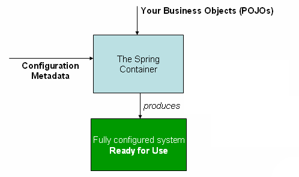

# IoC / DI

## IoC (Inversion of Control)

IoC는 **객체의 생성과 연결을 개발자 코드가 아니라 외부(컨테이너)가 맡는 것**이다. 제어의 흐름이 뒤집혔다고 해서 제어의 역전이라고 부른다.

IoC가 없으면 객체가 자기가 쓸 객체를 직접 만든다.

```java
public class OrderService {
    private final OrderRepository orderRepository = new JdbcOrderRepository();  // 직접 생성
}
```

- `OrderService`가 구현체 `JdbcOrderRepository`를 알고 있다.
- 저장소를 JPA로 바꾸려면 `OrderService` 코드를 고쳐야 한다.
- 테스트에서 가짜 저장소로 바꿔 끼우기도 어렵다.

IoC를 적용하면 `OrderService`는 인터페이스만 알고, 어떤 구현체를 쓸지는 외부에서 정한다.

```java
public class OrderService {
    private final OrderRepository orderRepository;

    public OrderService(OrderRepository orderRepository) {  // 외부에서 받음
        this.orderRepository = orderRepository;
    }
}
```

**라이브러리와 프레임워크의 차이**도 IoC로 설명할 수 있다.

- 라이브러리: 내 코드가 흐름을 쥐고 필요할 때 라이브러리를 호출한다.
- 프레임워크: 프레임워크가 흐름을 쥐고 내 코드를 호출한다. (`@Controller` 메서드를 언제 부를지는 Spring이 정한다.)

## DI (Dependency Injection)

DI는 IoC를 구현하는 방법 중 하나다. **객체가 의존하는 객체를 외부에서 넣어주는 것**이다.

Spring에서는 IoC 컨테이너(ApplicationContext)가 빈을 만들고 의존관계를 연결해준다.

```java
@Service
public class OrderService {
    private final OrderRepository orderRepository;

    public OrderService(OrderRepository orderRepository) {
        this.orderRepository = orderRepository;
    }
}

@Repository
public class JpaOrderRepository implements OrderRepository { ... }
```

컨테이너가 `JpaOrderRepository` 빈을 찾아서 `OrderService` 생성자에 넣어준다.



> 출처: [Container Overview (Spring 공식 문서)](https://docs.spring.io/spring-framework/reference/core/beans/basics.html)

내가 만든 클래스(POJO)와 설정 정보를 컨테이너에 넘기면, 의존관계가 다 연결된 상태의 애플리케이션이 만들어진다.

### 정적 의존관계와 동적 의존관계

- **정적 의존관계**: 코드의 import만 보고 알 수 있는 관계. `OrderService`는 `OrderRepository`에 의존한다.
- **동적 의존관계**: 실행 시점에 실제로 연결되는 객체. 어떤 구현체가 들어올지는 실행해봐야 안다.

DI를 쓰면 정적 의존관계는 그대로 두고 동적 의존관계만 바꿀 수 있다. OCP와 DIP를 지키기 쉬워지는 이유다.

## 주입 방식

### 생성자 주입

```java
@Service
public class OrderService {
    private final OrderRepository orderRepository;
    private final PaymentClient paymentClient;

    // 생성자가 하나면 @Autowired 생략 가능 (Spring 4.3+)
    public OrderService(OrderRepository orderRepository, PaymentClient paymentClient) {
        this.orderRepository = orderRepository;
        this.paymentClient = paymentClient;
    }
}
```

Lombok의 `@RequiredArgsConstructor`를 쓰면 `final` 필드로 생성자를 만들어준다.

### Setter 주입

```java
@Autowired
public void setPaymentClient(PaymentClient paymentClient) {
    this.paymentClient = paymentClient;
}
```

선택적이거나 실행 중에 바뀔 수 있는 의존관계에 쓴다. `@Autowired(required = false)`로 빈이 없어도 넘어가게 할 수 있다.

### 필드 주입

```java
@Autowired
private OrderRepository orderRepository;
```

코드는 짧지만 단점이 많다.

- `final`을 쓸 수 없다.
- Spring 컨테이너 없이는 값을 넣을 방법이 없다. 순수 단위 테스트가 어렵다.
- 의존성이 몇 개인지 생성자에 드러나지 않는다. 의존성이 많아져도 눈치채기 어렵다.

테스트 코드나 `@Configuration` 정도에서만 쓴다.

### 생성자 주입을 권장하는 이유

| 이유 | 설명 |
| --- | --- |
| 불변 | `final`로 선언해서 생성 이후 바뀌지 않게 할 수 있다. |
| 누락 방지 | 의존성을 빠뜨리면 컴파일 에러가 난다. |
| 테스트 용이 | `new OrderService(fakeRepository, fakeClient)`로 컨테이너 없이 테스트한다. |
| 순환 참조 조기 발견 | 애플리케이션 시작 시점에 `BeanCurrentlyInCreationException`으로 바로 실패한다. |
| 설계 신호 | 생성자 파라미터가 너무 많으면 클래스 책임이 과하다는 신호다. |

Spring Boot 2.6부터는 순환 참조를 기본으로 막는다(`spring.main.allow-circular-references=false`). 필드나 setter 주입이어도 시작 시점에 실패한다.

## 같은 타입의 빈이 여러 개일 때

`@Autowired`는 **타입**으로 빈을 찾는다. 후보가 둘 이상이면 `NoUniqueBeanDefinitionException`이 난다.

```java
@Component class KakaoPayClient implements PaymentClient { }
@Component class TossPayClient implements PaymentClient { }
```

해결 방법은 다음과 같다.

```java
// 1. @Primary: 기본으로 쓸 빈 지정
@Primary
@Component class KakaoPayClient implements PaymentClient { }

// 2. @Qualifier: 주입받는 쪽에서 이름으로 지정 (@Primary보다 우선)
public OrderService(@Qualifier("tossPayClient") PaymentClient paymentClient) { }

// 3. 파라미터 이름을 빈 이름과 맞추기 (타입 매칭 후 이름으로 한 번 더 비교)
public OrderService(PaymentClient tossPayClient) { }

// 4. 전부 받기
public OrderService(List<PaymentClient> clients) { }
public OrderService(Map<String, PaymentClient> clientMap) { }  // key = 빈 이름
```

`Map`으로 받으면 전략 패턴처럼 쓸 수 있다. 요청에 따라 `clientMap.get("tossPayClient")`로 골라 쓰는 식이다.
