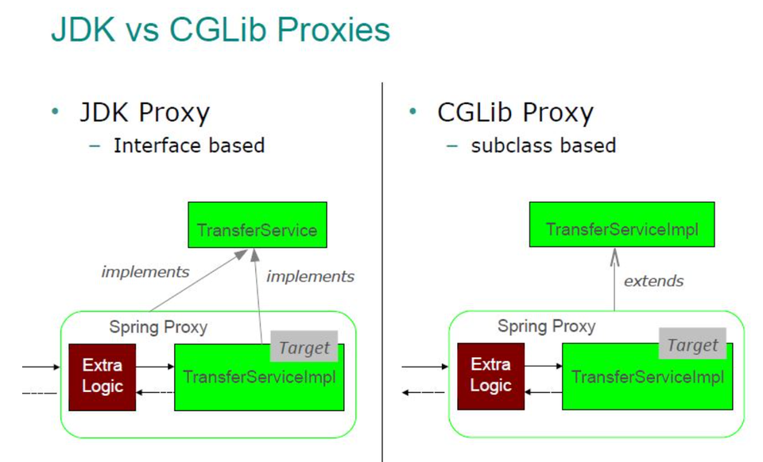
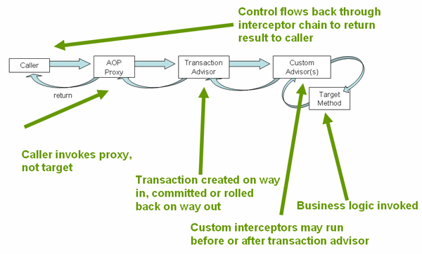
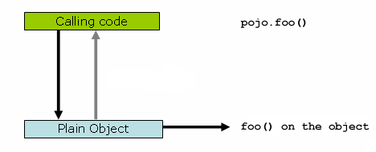
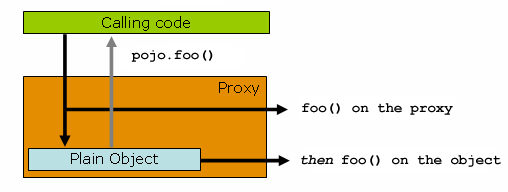

# Proxy

## 프록시란

프록시는 **클라이언트와 실제 객체(target) 사이에서 대신 호출을 받는 객체**다.

```text
클라이언트 → 프록시 → 실제 객체
```

클라이언트는 프록시인지 실제 객체인지 모른다. 같은 인터페이스(또는 같은 타입)를 쓰기 때문이다. 그래서 클라이언트 코드를 바꾸지 않고 기능을 끼워넣을 수 있다.

프록시를 쓰는 목적은 두 가지로 나눌 수 있다.

- **접근 제어 (프록시 패턴)**: 권한 확인, 캐싱, 지연 로딩 (JPA의 프록시 엔티티)
- **부가 기능 추가 (데코레이터 패턴)**: 로깅, 트랜잭션, 실행 시간 측정

Spring은 프록시를 AOP의 기반으로 쓴다. `@Transactional`, `@Cacheable`, `@Async`가 모두 프록시로 동작한다.

## 직접 만든 프록시의 한계

```java
public class OrderServiceTimeProxy implements OrderService {
    private final OrderService target;

    public void order(String itemId) {
        long start = System.currentTimeMillis();
        target.order(itemId);
        log.info("time={}", System.currentTimeMillis() - start);
    }
}
```

부가 기능은 똑같은데 대상 클래스마다 프록시 클래스를 만들어야 한다. 그래서 **동적 프록시**로 런타임에 프록시 클래스를 만든다.

## JDK 동적 프록시

Java 기본 기능(`java.lang.reflect.Proxy`)이다. **인터페이스 기반**으로 프록시를 만든다.

```java
public class TimeInvocationHandler implements InvocationHandler {
    private final Object target;

    @Override
    public Object invoke(Object proxy, Method method, Object[] args) throws Throwable {
        long start = System.currentTimeMillis();
        Object result = method.invoke(target, args);   // 리플렉션으로 실제 메서드 호출
        log.info("time={}", System.currentTimeMillis() - start);
        return result;
    }
}

OrderService proxy = (OrderService) Proxy.newProxyInstance(
        OrderService.class.getClassLoader(),
        new Class[]{OrderService.class},
        new TimeInvocationHandler(target));
```

- 만들어진 프록시는 인터페이스를 구현한 클래스(`$Proxy12` 같은 이름)다.
- 인터페이스가 없으면 쓸 수 없다.
- 프록시를 구체 클래스 타입으로 주입받으면 실패한다. `OrderServiceImpl`이 아니라 `OrderService`를 구현한 다른 클래스이기 때문이다.

## CGLIB

바이트코드를 조작해서 **대상 클래스를 상속한 하위 클래스**로 프록시를 만든다. Spring이 내부에 포함하고 있다(`org.springframework.cglib`).

```java
public class TimeMethodInterceptor implements MethodInterceptor {
    @Override
    public Object intercept(Object obj, Method method, Object[] args, MethodProxy proxy) throws Throwable {
        long start = System.currentTimeMillis();
        Object result = proxy.invoke(target, args);
        log.info("time={}", System.currentTimeMillis() - start);
        return result;
    }
}
```

- 인터페이스 없이 구체 클래스에도 쓸 수 있다.
- 상속 기반이라 제약이 있다.
  - `final` 클래스는 상속할 수 없어서 프록시를 만들 수 없다.
  - `final`, `private` 메서드는 오버라이드할 수 없어서 부가 기능이 적용되지 않는다.
  - 부모 생성자 호출 문제가 있었지만 Spring은 objenesis 라이브러리로 생성자 호출 없이 객체를 만들어 해결했다.

### 비교



> 출처: [Spring AOP와 @Transactional의 동작 원리 (velog @sangxxjin)](https://velog.io/@sangxxjin/j8mpm6uf)

왼쪽 JDK 프록시는 `TransferService` 인터페이스를 구현한다. 오른쪽 CGLIB 프록시는 `TransferServiceImpl`을 상속한다. 둘 다 부가 기능(Extra Logic)을 실행한 뒤 실제 객체(Target)를 호출한다.

| | JDK 동적 프록시 | CGLIB |
| --- | --- | --- |
| 방식 | 인터페이스 구현 | 클래스 상속 |
| 조건 | 인터페이스 필요 | `final`이 아니어야 함 |
| 구체 클래스 타입 주입 | 불가 | 가능 |

**Spring Boot는 기본으로 CGLIB을 쓴다.** (`spring.aop.proxy-target-class=true`) 인터페이스가 있어도 CGLIB으로 만든다. 구체 클래스로 주입받을 때 생기는 문제를 없애기 위해서다.

## Spring AOP와 프록시

Spring은 `ProxyFactory`로 두 기술을 추상화했다. 인터페이스가 있으면 JDK 동적 프록시, 없으면 CGLIB을 고를 수 있고 부가 기능은 `Advice`로 통일해서 작성한다.

AOP 용어는 다음과 같다.

- **Advice**: 프록시가 실행할 부가 기능 (트랜잭션 시작, 커밋)
- **Pointcut**: 부가 기능을 적용할 위치를 고르는 필터 (`@Transactional`이 붙은 메서드)
- **Advisor**: Pointcut 하나와 Advice 하나의 묶음
- **Aspect**: 여러 Advisor를 모은 것. `@Aspect` 클래스

**자동 프록시 생성 과정**

1. 빈 객체를 만든다.
2. `AnnotationAwareAspectJAutoProxyCreator`(BeanPostProcessor)가 컨테이너의 모든 Advisor를 찾는다.
3. Pointcut으로 이 빈의 메서드 중 적용 대상이 하나라도 있는지 확인한다.
4. 있으면 프록시를 만들어 원본 대신 컨테이너에 등록한다.

그래서 `@Transactional`이 붙은 서비스를 주입받아 클래스 이름을 찍어보면 `OrderService$$SpringCGLIB$$0`가 나온다.

### `@Transactional` 동작 예시



> 출처: [Understanding the Spring Framework's Declarative Transaction Implementation (Spring 공식 문서)](https://docs.spring.io/spring-framework/reference/data-access/transaction/declarative/tx-decl-explained.html)

호출하는 쪽은 실제 객체가 아니라 프록시를 부른다. 트랜잭션 Advisor가 들어가는 길에 트랜잭션을 시작하고, 나오는 길에 커밋하거나 롤백한다.

```java
// 프록시가 대략 이렇게 동작한다
public void order(String itemId) {
    TransactionStatus status = transactionManager.getTransaction(definition);
    try {
        target.order(itemId);              // 실제 객체 호출
        transactionManager.commit(status);
    } catch (RuntimeException e) {
        transactionManager.rollback(status);
        throw e;
    }
}
```

## 내부 호출 문제 (self-invocation)

프록시 기반 AOP의 대표적인 함정이다.

```java
@Service
public class OrderService {
    public void external() {
        internal();          // this.internal() → 프록시를 거치지 않음
    }

    @Transactional
    public void internal() { ... }
}
```

- 클라이언트가 `external()`을 부르면 프록시를 거쳐 실제 객체의 `external()`이 실행된다.
- 그 안의 `internal()`은 `this.internal()`이다. `this`는 프록시가 아니라 실제 객체다.
- 그래서 **트랜잭션이 적용되지 않는다.**





> 출처: [Proxying Mechanisms (Spring 공식 문서)](https://docs.spring.io/spring-framework/reference/core/aop/proxying.html)

첫 번째 그림은 프록시 없이 객체를 바로 부르는 경우다. 두 번째 그림에서는 외부 호출 `foo()`가 프록시를 거친다. 하지만 실제 객체 안에서 자기 메서드를 다시 부르면 프록시 바깥으로 나가지 않는다.

해결 방법은 다음과 같다.

- **별도 클래스로 분리 (권장)**: `internal()`을 다른 빈으로 옮기고 주입받아 호출한다. 외부 호출이 되니 프록시를 거친다.
- 자기 자신을 주입받기: `@Lazy`로 자기 프록시를 주입받는다. 순환 참조 설정 문제가 있어 잘 쓰지 않는다.
- `AopContext.currentProxy()`: `@EnableAspectJAutoProxy(exposeProxy = true)`가 필요하고 코드가 AOP에 묶인다.
- AspectJ 컴파일/로드 타임 위빙: 프록시가 아니라 바이트코드에 직접 넣는 방식이라 내부 호출도 적용된다. 설정이 복잡하다.

## 프록시 사용 시 주의할 점

- `private` 메서드에 `@Transactional`을 붙여도 동작하지 않는다. Spring 6부터는 `protected`와 패키지 접근 메서드에도 CGLIB 프록시 트랜잭션이 적용된다.
- `final` 클래스나 메서드에는 CGLIB 프록시가 적용되지 않는다. Kotlin은 클래스가 기본 `final`이라 `kotlin-spring`(all-open) 플러그인을 쓴다.
- 프록시는 빈 초기화가 끝난 뒤 만들어진다. `@PostConstruct` 안에서 호출한 `@Transactional` 메서드는 자기 자신 호출이라 트랜잭션이 적용되지 않는다. 이 경우 `ApplicationReadyEvent` 같은 이벤트에서 처리한다.
- JPA 엔티티의 지연 로딩 프록시도 같은 원리다. 엔티티를 상속한 프록시가 실제 엔티티 대신 들어가 있다가 처음 사용할 때 DB를 조회한다. (10주차 JPA에서 다룰 예정)
