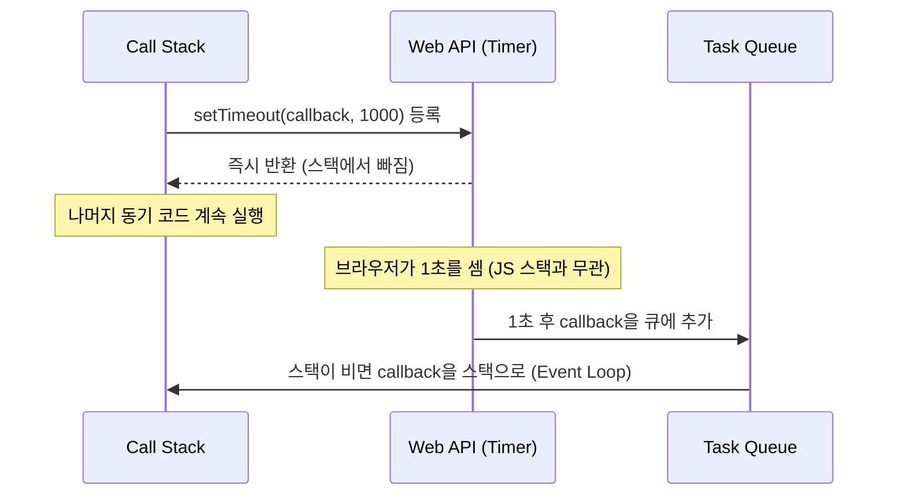

# [Week 9] 9주차 비동기 / Event Loop 정리

## 목차

1. [Call Stack](#1-call-stack)
2. [Web API](#2-web-api)
3. [Event Loop](#3-event-loop)
4. [Promise](#4-promise)
5. [async/await](#5-asyncawait)
6. [Microtask/Macrotask](#6-microtaskmacrotask)
7. [정리](#7-정리)

---

## 1. Call Stack

### 개념

- **Call Stack(호출 스택)**: 현재 실행 중인 함수와, 그 함수를 호출한 함수들의 **실행 컨텍스트를 쌓아두는 LIFO 구조** (3주차, 8주차)
- JS 엔진은 **싱글 스레드이고** Call Stack도 **하나이므로**, **한 번에 하나의 작업만** 실행할 수 있음 (2주차 JS Single Thread)

### 동작

```js
function first() {
  console.log('first start');
  second();
  console.log('first end');
}

function second() {
  console.log('second');
}

first();
```

```
①            ②             ③            ④
              ┌────────┐
              │second()│
┌────────┐    ├────────┤    ┌────────┐   ┌────────┐
│ first()│    │ first()│    │ first()│   │        │
├────────┤    ├────────┤    ├────────┤   ├────────┤
│ global │    │ global │    │ global │   │ global │
└────────┘    └────────┘    └────────┘   └────────┘
first 호출    second 호출   second 종료   first 종료
```

- 함수를 호출하면 push, 함수가 `return`하거나 끝나면 pop
- 출력 순서: `first start` → `second` → `first end`

### Stack Overflow

```js
function recurse() {
  recurse();            // 종료 조건 없는 재귀
}
recurse();              // RangeError: Maximum call stack size exceeded
```

- 스택은 **크기가 제한되어** 있어서 호출이 끝없이 쌓이면 넘침

### 스택을 오래 점유하면 생기는 일

```js
function block(ms) {
  const end = Date.now() + ms;
  while (Date.now() < end) {}     // 동기적으로 CPU를 계속 사용
}

setTimeout(() => console.log('timer'), 0);
block(3000);
console.log('done');
// 3초 동안 아무 일도 못 하다가: done → timer
```

- 동기 코드가 스택을 점유하는 동안 **타이머 콜백, 클릭 이벤트 처리, 화면 렌더링 모두 대기함** → 화면이 멈춘 것처럼 보임
- 그래서 **오래 걸리는 일(네트워크, 타이머, 파일)을 스택에서 기다리면 안 됨**

### 왜 비동기가 필요한가

| | 동기 (Synchronous) | 비동기 (Asynchronous) |
|---|---|---|
| 실행 방식 | 앞 작업이 끝나야 다음 작업 시작 | 작업을 맡겨두고 **기다리지 않고** 다음 코드 진행 |
| 결과 처리 | 바로 다음 줄에서 사용 | 완료 시점에 **콜백/Promise로** 전달 |
| 스택 점유 | 작업이 끝날 때까지 점유 | 요청 후 스택에서 바로 빠짐 |
| 예시 | 반복문, 계산 | 타이머, 네트워크 요청, 이벤트 |

- 싱글 스레드로 여러 일을 동시에 다루려면, **기다림이 필요한 작업을 스택 밖에 맡기고 결과가 준비되면 돌아와서 처리하는** 구조가 필요함 → 2장 Web API, 3장 Event Loop

---

## 2. Web API

### 개념

- **Web API**: JS 엔진이 아니라 **실행 환경(브라우저)이 제공하는 기능**
- `setTimeout`, `fetch`, `addEventListener`, `requestAnimationFrame` 등은 **JS 언어 스펙(ECMAScript)에 없는 것이고**, 브라우저가 제공함
- JS 엔진(V8)은 **Call Stack과 Heap만** 가지고 있고, 기다림이 필요한 일은 환경에 위임함

```
┌──────── JS Engine (V8) ────────┐        ┌────────── Browser ──────────┐
│   Heap        Call Stack       │        │   Web APIs                  │
│                                │ ─────► │   Timer, Network, DOM       │
│  (객체, 함수)  (실행 컨텍스트)    │ 위임    │   Events, rAF ...           │
└────────────────────────────────┘        └─────────────────────────────┘
```

- 브라우저는 별도의 스레드/프로세스에서 이 작업들을 처리함 (2주차 브라우저 Multi-Process 구조, 4주차 브라우저 Network 요청)
- Node.js에서는 같은 역할을 **libuv와 C++ API**(파일, 네트워크, 타이머)가 맡음

### 동작 흐름: setTimeout

```js
console.log('start');

setTimeout(() => {
  console.log('timeout callback');
}, 1000);

console.log('end');
// start → end → (1초 후) timeout callback
```



- `setTimeout` 호출 자체는 **즉시 끝나고** 스택에서 빠짐. 시간을 세는 일은 브라우저가 담당
- 시간이 지나면 **콜백을 바로 실행하지 않고 큐에 넣음** → 스택이 비어야 실행됨 (3장)

### setTimeout의 시간은 "최소 지연"

- 지정한 시간은 **"그 시간 이후에 큐에 넣는다"는** 의미이지 **정확히 그 시각에 실행한다는 보장이 아님**
- 스택이 바쁘면(1장의 `block` 예) 더 늦게 실행됨
- `setTimeout(fn, 0)`도 **즉시 실행이 아니라 현재 동기 코드가 모두 끝난 뒤** 실행됨
- 중첩 호출이 깊으면 최소 약 4ms, 비활성 탭에서는 더 길게 제한(throttle)되는 등 브라우저가 간격을 조정할 수 있음

### 주요 Web API

| 분류 | API | 설명 |
|---|---|---|
| 타이머 | `setTimeout`, `setInterval` | 일정 시간 후/주기적으로 콜백 실행 |
| 네트워크 | `fetch`, `XMLHttpRequest`, `WebSocket` | 서버와 통신 (4주차, 5주차) |
| DOM 이벤트 | `addEventListener` (click, scroll, input ...) | 사용자 동작/상태 변화에 콜백 실행 |
| 렌더링 | `requestAnimationFrame` | 다음 화면 렌더링 직전에 콜백 실행 |
| 관찰자 | `IntersectionObserver`, `ResizeObserver`, `MutationObserver` | 요소의 가시성/크기/DOM 변경 감지 |
| 저장소 | `IndexedDB` | 비동기 클라이언트 저장소 |
| 병렬 처리 | `Web Worker` | 별도 스레드에서 스크립트 실행 (2주차) |

---

## 3. Event Loop

### 개념

- **Event Loop**: **Call Stack이 비어 있는지 계속 확인하고**, 비어 있으면 **큐에서 다음 콜백을 꺼내 스택에 올려주는** 반복 메커니즘
- JS가 싱글 스레드이면서도 기다리지 않고(Non-blocking) 여러 일을 처리하는 것처럼 동작하게 해주는 핵심

### 구성 요소

| 구성 요소 | 역할 | 소속 |
|---|---|---|
| Call Stack | 현재 실행 중인 코드 | JS 엔진 |
| Web APIs | 타이머, 네트워크 등 비동기 작업 처리 | 브라우저 |
| Task Queue | 완료된 비동기 작업의 **콜백이 대기하는** 큐 (FIFO) | 브라우저 |
| Microtask Queue | Promise 콜백 등 **우선 처리되는** 큐 (6장) | JS 엔진 |
| Event Loop | 스택이 비면 큐에서 콜백을 꺼내 스택에 넣음 | 브라우저 |

```
        JS code
           │
           ▼
   ┌──────────────┐    비동기 작업 위임     ┌──────────────┐
   │  Call Stack  │ ─────────────────────► │   Web APIs   │
   └──────────────┘                        └──────┬───────┘
           ▲                                      │ 완료 → 콜백을 큐에 추가
           │ 스택이 비면 하나 꺼내서 push           ▼
   ┌───────┴──────┐        확인           ┌──────────────┐
   │  Event Loop  │ ◄──────────────────── │  Task Queue  │
   └──────────────┘                       └──────────────┘
```

### 가장 단순한 모델 (의사 코드)

```js
while (true) {
  if (callStack.isEmpty()) {
    const task = taskQueue.dequeue();   // 큐의 맨 앞(가장 먼저 들어온)
    if (task) callStack.push(task);
  }
}
```

- 6장에서 이 모델에 **Microtask Queue 처리 단계가** 추가됨

### 단계별로 따라가기

```js
console.log('A');
setTimeout(() => console.log('B'), 0);
console.log('C');
// A → C → B
```

| 단계 | Call Stack | Web API | Task Queue | 출력 |
|---|---|---|---|---|
| 1 | `console.log('A')` | | | A |
| 2 | `setTimeout(...)` | 타이머 등록 (0ms) | | |
| 3 | | 즉시 만료, 콜백을 큐에 추가 | `cb` | |
| 4 | `console.log('C')` | | `cb` | C |
| 5 | 비어 있음 → Event Loop가 큐에서 꺼냄 | | | |
| 6 | `cb` 실행 → `console.log('B')` | | | B |

- 타이머가 0ms여도 **스택에 남은 동기 코드(`console.log('C')`)가 먼저 끝나야** 콜백이 실행됨

### 핵심 규칙

- **콜백은 Call Stack이 완전히 비었을 때만** 실행됨 (실행 중인 코드를 중간에 끊지 않음)
- 큐는 **FIFO**: 먼저 큐에 들어온 콜백이 먼저 실행됨
- 비동기 콜백의 실행은 **항상 현재 동기 코드가 모두 끝난 이후**
- 큐에 들어가는 시점은 **작업이 완료된 시점이므로**, 먼저 등록해도 늦게 끝나면 늦게 실행됨

```js
setTimeout(() => console.log('slow'), 100);
setTimeout(() => console.log('fast'), 10);
// fast → slow (등록 순서가 아니라 "큐에 들어간 순서")
```

---

## 4. Promise

### 개념

- **Promise**: 비동기 작업의 **최종 결과(성공 또는 실패)를 나타내는 객체**
- "나중에 결과를 줄게"라는 약속의 영수증처럼, 결과가 나오기 전에도 값을 들고 다니며 **다음에 할 일을 이어 붙일 수** 있음

### 콜백 방식의 문제

```js
// 콜백 지옥: 순서대로 실행해야 할수록 코드가 오른쪽으로 깊어짐
getUser(id, (err, user) => {
  if (err) return handleError(err);
  getPosts(user.id, (err, posts) => {
    if (err) return handleError(err);
    getComments(posts[0].id, (err, comments) => {
      if (err) return handleError(err);
      console.log(comments);
    });
  });
});
```

- 중첩이 깊어져 읽기 어렵고, **에러 처리를 단계마다 반복해야** 함
- 콜백을 넘기는 순간 **호출 시점과 횟수를 상대 코드에 맡기는(제어 역전)** 문제도 있음

### 상태

```
                resolve(value)
          ┌───────────────────► fulfilled (성공)
pending ──┤
          └───────────────────► rejected  (실패)
                reject(reason)

fulfilled / rejected 를 합쳐 settled 라고 하며,
한 번 정해지면 다시 바뀌지 않음
```

| 상태 | 의미 |
|---|---|
| pending | 아직 결과가 나오지 않음 |
| fulfilled | 성공. 결과값을 가짐 |
| rejected | 실패. 실패 이유(에러)를 가짐 |

### 생성

```js
const promise = new Promise((resolve, reject) => {
  // executor: 생성되는 즉시 "동기적으로" 실행됨
  setTimeout(() => {
    const ok = Math.random() > 0.5;
    if (ok) resolve('성공 결과');
    else reject(new Error('실패 이유'));
  }, 1000);
});
```

```js
console.log(1);
new Promise((resolve) => {
  console.log(2);      // executor는 동기 실행
  resolve();
}).then(() => console.log(3));   // then 콜백은 비동기 (6장)
console.log(4);
// 1 → 2 → 4 → 3
```

### 소비: then / catch / finally

```js
promise
  .then((value) => console.log('성공:', value))
  .catch((error) => console.log('실패:', error.message))
  .finally(() => console.log('성공/실패와 무관하게 항상 실행'));
```

| 메서드 | 실행 조건 |
|---|---|
| `then(onFulfilled)` | fulfilled 되었을 때 |
| `catch(onRejected)` | rejected 되었을 때 (`then(undefined, onRejected)`와 같음) |
| `finally(fn)` | settled 되었을 때. 정리 작업용이고 결과값을 바꾸지 않음 |

### 체이닝

- `then`/`catch`/`finally`는 **항상 새로운 Promise를 반환하므로** 이어서 붙일 수 있음
- 콜백이 **반환한 값이 다음 `then`의 입력이** 됨

```js
fetchUser(1)
  .then((user) => user.id)                 // 값을 반환 → 다음 then으로 전달
  .then((id) => fetchPosts(id))            // Promise를 반환 → 완료될 때까지 기다렸다가 결과 전달
  .then((posts) => posts[0])
  .then((post) => console.log(post.title))
  .catch((err) => console.error(err));     // 위 체인 어디서든 발생한 에러를 한 곳에서 처리
```

| then 콜백이 | 다음 Promise |
|---|---|
| 값을 반환 | 그 값으로 fulfilled |
| Promise를 반환 | 그 Promise의 결과를 따라감 (풀어서 전달) |
| 에러를 throw | rejected |
| 아무것도 반환 안 함 | `undefined`로 fulfilled |

### 에러 전파

```js
Promise.resolve()
  .then(() => { throw new Error('boom'); })
  .then(() => console.log('실행되지 않음'))     // rejected 상태라 건너뜀
  .catch((e) => {
    console.log('잡음:', e.message);
    return '복구된 값';                         // catch가 값을 반환하면 이후 체인은 정상으로 복구
  })
  .then((v) => console.log(v));                // '복구된 값'
```

- 에러는 **다음 `catch`를 만날 때까지** 아래로 전파되고, 중간의 `then`들은 건너뜀
- `catch`에서 값을 반환하면 체인이 **정상 상태로 복구됨**

### 정적 메서드

| 메서드 | 동작 | 결과 |
|---|---|---|
| `Promise.resolve(v)` / `reject(e)` | 이미 settled된 Promise 생성 | |
| `Promise.all([...])` | **모두 성공해야** 성공. 하나라도 실패하면 즉시 reject | 결과 배열 (입력 순서대로) |
| `Promise.allSettled([...])` | 성공/실패와 무관하게 **모두 끝날 때까지** 기다림 | `{status, value/reason}` 배열 |
| `Promise.race([...])` | 가장 먼저 **settled된** 것의 결과를 따름 (성공이든 실패든) | 첫 번째 결과 |
| `Promise.any([...])` | 가장 먼저 **fulfilled된** 것의 결과. 전부 실패하면 `AggregateError` | 첫 번째 성공 결과 |

```js
const sleep = (ms, v) => new Promise((r) => setTimeout(() => r(v), ms));

await Promise.all([sleep(300, 'a'), sleep(100, 'b')]);       // ['a', 'b']  (입력 순서, 약 300ms)
await Promise.race([sleep(300, 'a'), sleep(100, 'b')]);      // 'b'         (가장 먼저 끝난 것)

const results = await Promise.allSettled([
  fetch('/api/a'),
  fetch('/api/b'),
]);
// [{ status: 'fulfilled', value: Response }, { status: 'rejected', reason: Error }]
```

| 상황 | 선택 |
|---|---|
| 모든 요청이 성공해야 의미가 있음 | `all` |
| 일부 실패해도 나머지 결과를 쓰고 싶음 | `allSettled` |
| 타임아웃 구현 (요청 vs 타이머) | `race` |
| 여러 미러 서버 중 가장 빠른 성공 | `any` |

### 흔한 실수

```js
// ① then 안에서 return을 빠뜨림 → 다음 then이 undefined를 받고, 완료를 기다리지도 않음
fetchUser().then((user) => {
  fetchPosts(user.id);              // return 없음
}).then((posts) => console.log(posts));   // undefined

// ② 체이닝 대신 중첩 → 콜백 지옥과 다를 바 없음
fetchUser().then((user) => {
  fetchPosts(user.id).then((posts) => { /* ... */ });
});

// ③ 이미 Promise인 것을 new Promise로 다시 감쌈
new Promise((resolve) => fetch('/api').then(resolve));   // 그냥 fetch('/api')를 쓰면 됨

// ④ catch 없이 방치 → Unhandled Promise Rejection
fetch('/api').then((res) => res.json());   // 실패해도 처리되지 않음
```

- `catch`로 처리되지 않은 reject는 브라우저에서 콘솔 에러가 나고, Node.js에서는 프로세스가 종료될 수 있음

---

## 5. async/await

### 개념

- **async/await**: Promise를 **동기 코드처럼 읽히게** 작성하는 문법 (Promise 위의 문법적 편의)
- `async` 함수는 **항상 Promise를 반환하고**, `await`는 Promise가 settled될 때까지 **그 함수의 실행을 일시 중단함**
- 중단되는 것은 **그 async 함수뿐이고, 스택과 스레드는 막히지 않음** (다른 코드는 계속 실행됨)

```js
// Promise 체이닝
function load() {
  return fetchUser(1)
    .then((user) => fetchPosts(user.id))
    .then((posts) => posts[0])
    .catch((e) => console.error(e));
}

// async/await
async function load() {
  try {
    const user = await fetchUser(1);
    const posts = await fetchPosts(user.id);
    return posts[0];
  } catch (e) {
    console.error(e);
  }
}
```

### async 함수의 반환값

```js
async function a() { return 1; }          // Promise.resolve(1) 과 같음
async function b() { throw new Error('x'); } // Promise.reject(new Error('x')) 와 같음

a().then((v) => console.log(v));   // 1
b().catch((e) => console.log(e.message)); // 'x'
```

- `async` 함수는 **일반 값을 반환해도 Promise로 감싸서** 돌려줌 → 호출하는 쪽도 `await`나 `then`으로 받아야 함

### await의 동작

```js
async function f() {
  console.log(1);
  await null;            // 여기서 f의 실행이 중단되고, 호출한 곳으로 제어권이 돌아감
  console.log(3);        // 나중에 Microtask로 재개됨
}

f();
console.log(2);
// 1 → 2 → 3
```

- `await` **앞의 코드는 동기적으로 실행되고**, `await` **뒤의 코드는 Promise가 처리된 뒤 Microtask로 재개됨**
- 사실상 **`await` 뒤의 코드가 `.then()`의 콜백이** 되는 것과 같음

```js
async function f() {
  const a = await p1;
  const b = await p2;
  return a + b;
}

// 개념적으로 이렇게 동작
function f() {
  return p1.then((a) => p2.then((b) => a + b));
}
```

### 에러 처리

```js
async function load() {
  try {
    const res = await fetch('/api/users');
    if (!res.ok) throw new Error(`HTTP ${res.status}`);   // fetch는 직접 확인 (5주차)
    return await res.json();
  } catch (e) {
    console.error('실패:', e);
    throw e;                                              // 필요하면 다시 던져서 호출한 쪽이 처리
  } finally {
    hideSpinner();                                        // 성공/실패와 무관하게 정리
  }
}
```

- `await`한 Promise가 reject되면 그 자리에서 **예외가 throw되므로** `try/catch`로 잡을 수 있음
- `try` 안에서 Promise를 `return`하면 `catch`에 걸리지 않으므로, **같은 함수에서 에러를 처리하려면 `return await`를** 사용

```js
async function a() {
  try { return fetchData(); }         // reject돼도 이 catch는 동작하지 않음
  catch (e) { /* ... */ }
}

async function b() {
  try { return await fetchData(); }   // reject되면 이 catch에서 잡힘
  catch (e) { /* ... */ }
}
```

### 순차 vs 병렬

```js
// 순차: 서로 관련이 없는데도 하나씩 기다림 → 시간이 합산됨 (약 2초)
const user = await fetchUser();       // 1초
const settings = await fetchSettings(); // 1초

// 병렬: 동시에 시작하고 함께 기다림 → 가장 느린 쪽 기준 (약 1초)
const [user2, settings2] = await Promise.all([fetchUser(), fetchSettings()]);
```

- **서로 의존하지 않는 요청은 `Promise.all`로 병렬 처리하는** 것이 기본
- 앞 결과가 필요한 경우(user의 id로 posts 조회 등)에만 순차 `await`

### 반복문에서의 await

```js
// ① for...of: 순차 처리 (하나 끝나면 다음)
for (const item of items) {
  await save(item);
}

// ② map + Promise.all: 병렬 처리
await Promise.all(items.map((item) => save(item)));

// ③ forEach + async: 잘못된 사용
items.forEach(async (item) => {
  await save(item);
});
console.log('끝');   // save가 끝나기 전에 먼저 출력됨 (forEach는 Promise를 기다리지 않음)
```

- `forEach`는 콜백이 반환한 Promise를 **무시하므로**, 반복문 전체가 끝났음을 기다릴 방법이 없음

### React useEffect에서의 사용

```jsx
// 잘못된 사용: effect 함수 자체를 async로 만들면 Promise를 반환하게 되어 cleanup 함수로 쓰이지 않음
useEffect(async () => { /* ... */ }, []);

// 올바른 사용: 내부에 async 함수를 정의해서 호출
useEffect(() => {
  let ignore = false;

  (async () => {
    const user = await getUser(id);
    if (!ignore) setUser(user);      // 언마운트/id 변경 후 도착한 오래된 응답은 무시
  })();

  return () => { ignore = true; };   // cleanup
}, [id]);
```

---

## 6. Microtask/Macrotask

### 개념

- Event Loop가 콜백을 보관하는 큐는 **두 종류이고**, 처리 우선순위가 다름

| | Macrotask (Task) | Microtask |
|---|---|---|
| 대표 예시 | `setTimeout`, `setInterval`, DOM 이벤트(click 등), I/O, `MessageChannel` | `Promise.then/catch/finally`, `async/await` 재개, `queueMicrotask`, `MutationObserver` |
| 우선순위 | 낮음 | **높음** |
| 처리 방식 | 한 사이클에 **하나만** 실행 | 큐가 **빌 때까지 전부** 실행 |
| 큐 | Task Queue | Microtask Queue |

### 이벤트 루프 한 사이클

```
┌─► ① Macrotask 하나를 꺼내 실행
│            │
│            ▼
│   ② Microtask Queue를 "빌 때까지" 모두 실행
│      (실행 중에 새로 추가된 Microtask도 포함)
│            │
│            ▼
│   ③ 렌더링 (필요한 경우)
│      requestAnimationFrame → Style → Layout → Paint
│            │
└────────────┘  ④ 다음 사이클
```

- **스크립트 전체의 실행도 하나의 Macrotask임**. 동기 코드가 끝나면 → Microtask를 모두 처리 → 그다음에야 `setTimeout` 같은 다음 Macrotask로 넘어감
- Microtask는 **콜백이 끝나 스택이 비는 순간마다** 처리됨

### 대표 예제

```js
console.log('1');                                  // 동기

setTimeout(() => console.log('2'), 0);             // Macrotask

Promise.resolve().then(() => console.log('3'));    // Microtask

console.log('4');                                  // 동기
// 1 → 4 → 3 → 2
```

| 단계 | 실행되는 것 | 출력 |
|---|---|---|
| 1 | 스크립트(Macrotask) 실행: 동기 코드 `1`, `4`. `setTimeout`은 큐로, `then`은 Microtask 큐로 | 1, 4 |
| 2 | 스크립트 종료 → **Microtask Queue 비우기** | 3 |
| 3 | (렌더링 기회) | |
| 4 | 다음 Macrotask: `setTimeout` 콜백 | 2 |

- `setTimeout(..., 0)`보다 **Promise의 `then`이 항상 먼저** 실행됨

### 여러 단계의 Microtask

```js
console.log('script start');

setTimeout(() => console.log('setTimeout'), 0);

Promise.resolve()
  .then(() => console.log('promise1'))
  .then(() => console.log('promise2'));

console.log('script end');
// script start → script end → promise1 → promise2 → setTimeout
```

- `promise1`이 끝나면서 `promise2`가 Microtask 큐에 추가되는데, Microtask는 **큐가 빌 때까지 계속 처리하므로** `setTimeout`(Macrotask)보다 먼저 실행됨

### async/await 실행 순서

```js
async function a() {
  console.log('a1');
  await b();                // b()는 동기적으로 실행되고, 이후 코드는 Microtask로 예약
  console.log('a2');
}

async function b() {
  console.log('b');
}

console.log('start');
a();
console.log('end');
// start → a1 → b → end → a2
```

| 순서 | 설명 |
|---|---|
| `start` | 동기 실행 |
| `a1`, `b` | `a()` 호출 → `await b()`에서 `b()`는 **즉시 동기 실행** |
| `end` | `await`에서 `a`가 중단되고 제어권이 돌아와서 계속 실행 |
| `a2` | 동기 코드가 끝난 뒤, `await` 이후의 코드가 **Microtask로 재개** |

### Microtask 안에서 추가되는 작업

```js
setTimeout(() => console.log('macro 1'), 0);

Promise.resolve().then(() => {
  console.log('micro 1');
  Promise.resolve().then(() => console.log('micro 2'));   // 같은 사이클에서 처리됨
  setTimeout(() => console.log('macro 2'), 0);            // 다음 사이클로 넘어감
});
// micro 1 → micro 2 → macro 1 → macro 2
```

- Microtask 안에서 추가된 **Microtask는 같은 사이클에서 바로 처리되고**, 추가된 **Macrotask는 큐 맨 뒤로** 감

### 실행 순서 예측 연습

```js
console.log('1');

setTimeout(() => {
  console.log('2');
  Promise.resolve().then(() => console.log('3'));
}, 0);

Promise.resolve().then(() => {
  console.log('4');
  setTimeout(() => console.log('5'), 0);
});

console.log('6');
```

**답: `1 → 6 → 4 → 2 → 3 → 5`**

| 단계 | 상태 | 출력 |
|---|---|---|
| 스크립트 실행 | 동기 코드 실행, Task Queue: `[T1]`, Microtask Queue: `[M1]` | 1, 6 |
| Microtask 비우기 | M1 실행 → `setTimeout`으로 T2 추가. Task Queue: `[T1, T2]` | 4 |
| Macrotask: T1 | `2` 출력, Microtask M2 추가 | 2 |
| T1 종료 후 Microtask 비우기 | M2 실행 | 3 |
| Macrotask: T2 | | 5 |

### Microtask Starvation

```js
function loop() {
  Promise.resolve().then(loop);   // Microtask가 끊임없이 새 Microtask를 만듦
}
loop();
// Microtask Queue가 영원히 비지 않아서, 렌더링과 모든 Macrotask(클릭, 타이머)가 실행되지 못함 → 화면 멈춤
```

```js
function loop() {
  setTimeout(loop, 0);            // Macrotask는 사이사이에 렌더링과 다른 이벤트 처리가 끼어들 수 있음
}
```

- Microtask는 **큐가 빌 때까지 멈추지 않으므로**, 끝없이 만들어내면 브라우저가 멈춤

---

## 7. 정리

| 개념 | 핵심 |
|---|---|
| Call Stack | 실행 중인 함수가 쌓이는 LIFO 구조. 하나뿐이라 동기 코드가 길면 모든 것이 멈춤 |
| Web API | `setTimeout`, `fetch`, 이벤트 등 **JS 엔진 밖(브라우저)이** 처리하는 비동기 기능 |
| Event Loop | 스택이 비면 큐에서 콜백을 꺼내 스택에 넣는 반복 메커니즘 |
| Promise | 비동기 결과를 나타내는 객체. pending → fulfilled/rejected, 체이닝과 에러 전파 |
| async/await | Promise를 동기 코드처럼 작성. `await` 이후는 Microtask로 재개 |
| Microtask/Macrotask | Microtask(Promise 등)는 큐가 빌 때까지 모두, Macrotask(타이머 등)는 사이클당 하나 |

### 실행 우선순위

```
① 동기 코드 (현재 스택의 모든 코드)
        ▼
② Microtask 전부 (Promise.then, await 이후, queueMicrotask)
        ▼
③ 렌더링 (rAF → Style → Layout → Paint)
        ▼
④ Macrotask 하나 (setTimeout, 이벤트, I/O)  →  ②로 돌아감
```

| 코드 | 분류 | 실행 순서 |
|---|---|---|
| `console.log` 등 동기 코드 | 동기 | 가장 먼저 |
| `Promise.then`, `await` 이후 | Microtask | 동기 코드 직후 |
| `requestAnimationFrame` | 렌더링 단계 | Microtask 이후, 렌더링 직전 |
| `setTimeout`, `setInterval`, 클릭 이벤트 | Macrotask | 가장 나중 |