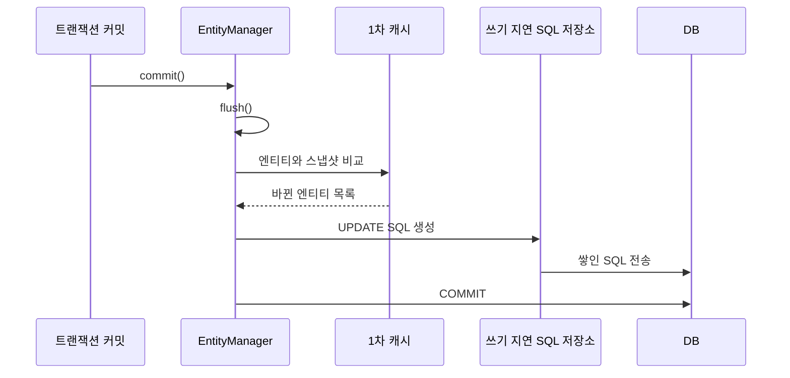

# Dirty Checking / Flush

## 변경 감지 (Dirty Checking)

JPA에는 `update()` 메서드가 없다. 영속 엔티티의 값을 바꾸기만 하면 커밋할 때 UPDATE가 나간다.

```java
@Transactional
public void changeName(Long id, String name) {
    Member member = em.find(Member.class, id);
    member.changeName(name);
    // em.update(member) 같은 호출이 필요 없다
}
```

### 동작 원리



1. 엔티티를 처음 영속 상태로 만들 때 스냅샷을 1차 캐시에 저장한다.
2. flush가 일어나면 모든 영속 엔티티를 스냅샷과 필드 단위로 비교한다.
3. 바뀐 엔티티가 있으면 UPDATE SQL을 만들어 쓰기 지연 저장소에 넣는다.
4. 쌓인 SQL을 DB로 보내고 커밋한다.

### 알아둘 점

- **영속 상태에서만** 동작한다. 준영속이나 비영속 엔티티는 값을 바꿔도 아무 일도 없다.
- 기본으로 **모든 컬럼을 UPDATE**한다.
  - 바뀐 필드와 상관없이 SQL 모양이 같아서 Hibernate가 미리 만들어둔 SQL을 재사용할 수 있다.
  - DB도 같은 SQL을 파싱해서 재사용하기 쉽다.
  - 컬럼이 많으면 `@DynamicUpdate`로 바뀐 컬럼만 UPDATE하게 할 수 있다.
- 영속 엔티티가 많으면 비교 비용이 커진다. 조회만 하는 트랜잭션은 `@Transactional(readOnly = true)`를 쓴다.
  - Spring은 Hibernate 세션의 flush 모드를 `MANUAL`로 바꾼다. 그래서 flush와 변경 감지가 일어나지 않는다.
  - Hibernate는 읽기 전용 엔티티의 스냅샷을 보관하지 않아 메모리도 아낀다.

### 엔티티에 setter를 열지 않는 이유

변경 감지 때문에 엔티티 필드를 바꾸는 것만으로 DB가 바뀐다. setter가 열려 있으면 어디서 값을 바꿨는지 추적하기 어렵다. 그래서 `changeName()`처럼 의도가 드러나는 메서드를 만든다.

## Flush

flush는 **영속성 컨텍스트의 변경 내용을 DB에 반영하는 것**이다.

- 변경 감지를 해서 UPDATE를 만든다.
- 쓰기 지연 저장소의 SQL을 DB에 보낸다.
- **영속성 컨텍스트를 비우지 않는다.** 1차 캐시는 그대로 남는다. (비우는 건 `clear()`)
- **커밋이 아니다.** SQL만 보낸 상태라 트랜잭션이 롤백되면 같이 취소된다.

### flush가 일어나는 시점

| 시점 | 설명 |
| --- | --- |
| `em.flush()` 직접 호출 | 테스트나 대량 처리에서 쓴다 |
| 트랜잭션 커밋 | 커밋 직전에 자동으로 flush |
| JPQL 실행 | 쿼리 실행 직전에 자동으로 flush |

**JPQL 실행 전에 flush하는 이유**

```java
em.persist(memberA);
em.persist(memberB);

// flush가 없으면 아직 DB에 A, B가 없어서 결과가 비어 있게 된다
List<Member> members = em.createQuery("select m from Member m", Member.class).getResultList();
```

JPQL은 DB에 바로 쿼리를 날린다. 그래서 아직 DB에 반영하지 않은 변경 내용이 결과에 빠지지 않도록 먼저 flush한다.

### FlushModeType

```java
em.setFlushMode(FlushModeType.AUTO);    // 기본값. 커밋, 쿼리 실행 시 flush
em.setFlushMode(FlushModeType.COMMIT);  // 커밋할 때만 flush
```

- Hibernate의 `AUTO`는 JPQL이 건드리는 테이블에 변경이 있을 때만 flush한다.
- 네이티브 쿼리는 어떤 테이블을 쓰는지 분석하지 않는다. Hibernate 네이티브 API를 직접 쓰면 flush하지 않을 수 있어서 주의한다. JPA 표준 API로 실행한 네이티브 쿼리는 flush한다.

## 벌크 연산 주의

```java
@Modifying
@Query("update Member m set m.age = m.age + 1")
int bulkAgePlus();
```

- 벌크 UPDATE, DELETE는 영속성 컨텍스트를 거치지 않고 DB에 바로 실행한다.
- 실행 전에 flush는 되지만, 실행 후 1차 캐시의 엔티티는 **옛날 값 그대로**다.
- 그래서 벌크 연산 뒤에 같은 트랜잭션에서 엔티티를 다시 쓴다면 영속성 컨텍스트를 비워야 한다.

```java
@Modifying(clearAutomatically = true)
```
