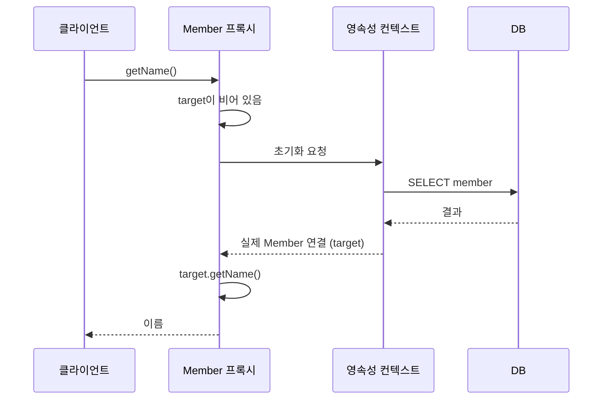

# Lazy / Eager

## 연관 엔티티를 언제 불러올까

```java
@Entity
public class Order {
    @ManyToOne(fetch = FetchType.LAZY)
    @JoinColumn(name = "member_id")
    private Member member;
}
```

`Order`를 조회할 때 `Member`도 같이 가져올지 정하는 게 fetch 전략이다.

| | 즉시 로딩 (EAGER) | 지연 로딩 (LAZY) |
| --- | --- | --- |
| 조회 시점 | 엔티티를 조회할 때 같이 | 연관 엔티티를 실제로 쓸 때 |
| 들어가는 값 | 실제 엔티티 | 프록시 객체 |
| 쿼리 | 조인 또는 추가 SELECT | 쓸 때 추가 SELECT |

### 기본값

| 연관관계 | 기본 fetch |
| --- | --- |
| `@ManyToOne`, `@OneToOne` | EAGER |
| `@OneToMany`, `@ManyToMany` | LAZY |

`~ToOne`의 기본값이 EAGER라서 **직접 `LAZY`로 바꿔야 한다.**

## 지연 로딩과 프록시

지연 로딩은 9주차에서 본 프록시를 쓴다.

```java
Order order = em.find(Order.class, 1L);   // SELECT * FROM orders WHERE id = 1
Member member = order.getMember();        // Member$HibernateProxy$xxx. 쿼리 없음
member.getName();                         // 이때 SELECT * FROM member WHERE id = ?
```



- 프록시는 실제 엔티티 클래스를 상속해서 만든다. 그래서 겉으로는 `Member` 타입이다.
- 프록시는 ID만 들고 있다. `getId()`는 초기화 없이 바로 돌려준다.
- 처음 실제 값을 쓸 때 **한 번만 초기화**한다. 프록시가 실제 엔티티로 바뀌는 게 아니라, 프록시 안의 target이 채워진다.
- `em.getReference()`로 직접 프록시를 받을 수도 있다.

### 프록시 사용 시 주의할 점

- **타입 비교는 `instanceof`로 한다.** 프록시는 하위 클래스라 `getClass() ==`로 비교하면 다르게 나온다.
- 이미 1차 캐시에 실제 엔티티가 있으면 `getReference()`도 실제 엔티티를 준다. 반대로 프록시를 먼저 받았으면 `find()`도 같은 프록시를 준다. 동일성(`==`)을 지키기 위해서다.
- `equals()`를 직접 구현할 때 필드에 바로 접근하지 말고 getter를 쓴다. 프록시의 필드는 비어 있다.
- 엔티티 클래스와 메서드를 `final`로 만들면 프록시를 만들 수 없다.

### LazyInitializationException

```java
@Transactional(readOnly = true)
public Order findOrder(Long id) {
    return orderRepository.findById(id).orElseThrow();
}

// 컨트롤러에서
order.getMember().getName();   // LazyInitializationException
```

- 프록시 초기화는 영속성 컨텍스트가 살아 있어야 한다.
- 트랜잭션이 끝나서 영속성 컨텍스트가 닫힌 뒤 초기화하려고 하면 예외가 난다.
- 해결 방법
  - 트랜잭션 안에서 필요한 데이터를 다 불러온다. (fetch join, DTO 변환)
  - OSIV를 켠다. (아래 참고)

## 실무에서는 전부 LAZY

EAGER를 쓰지 않는 이유는 다음과 같다.

- **예상하지 못한 SQL이 나간다.** 연관관계가 많아지면 엔티티 하나 조회에 조인이 줄줄이 붙는다.
- **JPQL에서 N+1이 생긴다.** `em.find()`는 EAGER를 보고 조인을 해주지만, JPQL은 쿼리를 그대로 SQL로 바꾼다. 조회 후 EAGER 연관을 채우려고 엔티티마다 SELECT를 또 날린다. ([N+1](./n-plus-one.md))
- 필요한 경우만 fetch join이나 `@EntityGraph`로 같이 가져오면 된다.

## OSIV (Open Session In View)

Spring Boot에서 `spring.jpa.open-in-view`의 기본값은 `true`다. 시작할 때 경고 로그가 찍힌다.

```text
트랜잭션 시작 ─────── 트랜잭션 종료
   │ 서비스 계층 │
───────────────────────────────────────────────
요청 시작 ─────── 영속성 컨텍스트 (OSIV true) ─────── 응답 완료
```

| | OSIV true | OSIV false |
| --- | --- | --- |
| 영속성 컨텍스트 범위 | 요청 시작부터 응답까지 | 트랜잭션 범위 |
| 컨트롤러, 뷰에서 지연 로딩 | 가능 (조회만) | 불가 |
| DB 커넥션 반환 | 응답이 끝날 때 | 트랜잭션이 끝날 때 |

- OSIV를 켜면 편하지만 **DB 커넥션을 응답이 끝날 때까지 붙잡는다.** 외부 API 호출처럼 오래 걸리는 작업이 컨트롤러에 있으면 커넥션 풀이 금방 바닥난다.
- 트래픽이 많은 API 서버는 보통 끈다. 대신 서비스 계층에서 필요한 데이터를 다 불러와 DTO로 바꿔서 넘긴다.
- 화면이 많은 관리자 페이지처럼 커넥션 부담이 적은 곳은 켜두기도 한다.
