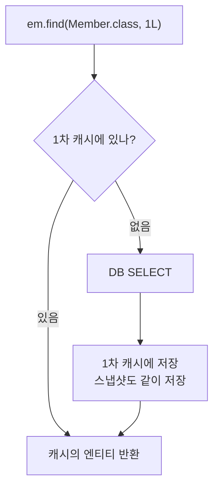

# 1차 Cache

## 1차 캐시란

영속성 컨텍스트 안에는 **`@Id`를 키로, 엔티티 객체를 값으로 가지는 Map**이 있다. 이것을 1차 캐시라고 한다.

```text
영속성 컨텍스트
┌───────────────────────────────┐
│ 1차 캐시                       │
│  @Id │ Entity   │ 스냅샷        │
│  1L  │ member1  │ member1 복사본 │
│  2L  │ member2  │ member2 복사본 │
├───────────────────────────────┤
│ 쓰기 지연 SQL 저장소             │
│  INSERT ..., UPDATE ...        │
└───────────────────────────────┘
```

스냅샷은 엔티티가 처음 영속 상태가 됐을 때의 값이다. 변경 감지에서 쓴다. ([Dirty Checking](./dirty-checking-flush.md))

## 조회 흐름

```java
Member a = em.find(Member.class, 1L);   // 1차 캐시에 없음 → SELECT 실행 → 캐시에 저장
Member b = em.find(Member.class, 1L);   // 1차 캐시에서 바로 반환. SQL 없음
```



### JPQL은 1차 캐시를 먼저 보지 않는다

```java
em.createQuery("select m from Member m where m.id = 1", Member.class).getSingleResult();
```

- JPQL은 SQL로 번역돼서 **항상 DB에 쿼리를 날린다.**
- 결과를 받은 뒤 같은 ID의 엔티티가 1차 캐시에 이미 있으면 **DB 결과를 버리고 캐시에 있는 객체를 돌려준다.**
- 그래서 그 사이에 DB 값이 바뀌었어도 영속성 컨텍스트에 있는 값이 우선한다.
- Spring Data JPA의 `findById()`는 `em.find()`라 캐시를 먼저 본다. `findByName()` 같은 쿼리 메서드는 JPQL이라 항상 SQL이 나간다.

## 동일성 보장

```java
Member a = em.find(Member.class, 1L);
Member b = em.find(Member.class, 1L);
System.out.println(a == b);   // true
```

같은 영속성 컨텍스트 안에서 같은 ID로 조회하면 항상 같은 객체가 나온다.

- 자바 컬렉션에서 꺼낸 객체를 비교하는 것처럼 쓸 수 있다.
- DB 격리 수준이 READ COMMITTED여도 애플리케이션 레벨에서는 **REPEATABLE READ처럼 동작**한다. 같은 트랜잭션에서 같은 엔티티를 다시 읽어도 처음 값이 나온다.

## 쓰기 지연

```java
@Transactional
public void join() {
    em.persist(memberA);   // INSERT SQL을 쓰기 지연 저장소에 쌓기만 함
    em.persist(memberB);
    // 커밋 직전 flush → INSERT 두 개 실행
}
```

- SQL을 모아뒀다가 flush 시점에 한 번에 보낸다.
- `hibernate.jdbc.batch_size`를 설정하면 JDBC 배치로 묶어서 보낼 수 있다.
  - `IDENTITY` 전략은 `persist()` 때 INSERT를 바로 실행해야 해서 INSERT 배치가 안 된다.

## 1차 캐시의 한계

- **트랜잭션 범위**라서 트랜잭션이 끝나면 사라진다. 요청이 다르면 공유되지 않는다.
- 그래서 애플리케이션 전체 성능을 크게 올려주지는 않는다. 같은 트랜잭션 안에서 같은 엔티티를 여러 번 조회할 때 이득이 있다.
- 애플리케이션 전체에서 공유하는 캐시는 **2차 캐시**(Hibernate second-level cache, Ehcache 등)다. 실무에서는 보통 2차 캐시 대신 Redis 같은 별도 캐시를 서비스 계층에 둔다.
- 대량 데이터를 처리하면 1차 캐시에 엔티티가 계속 쌓여서 메모리가 부족해질 수 있다. 일정 단위마다 `flush()`, `clear()`를 호출한다.

```java
for (int i = 0; i < 100_000; i++) {
    em.persist(new Item(i));
    if (i % 1000 == 0) {
        em.flush();
        em.clear();
    }
}
```
