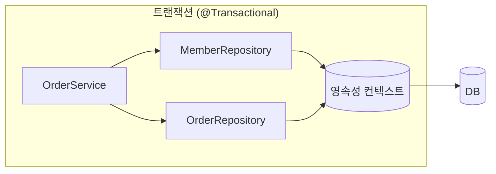
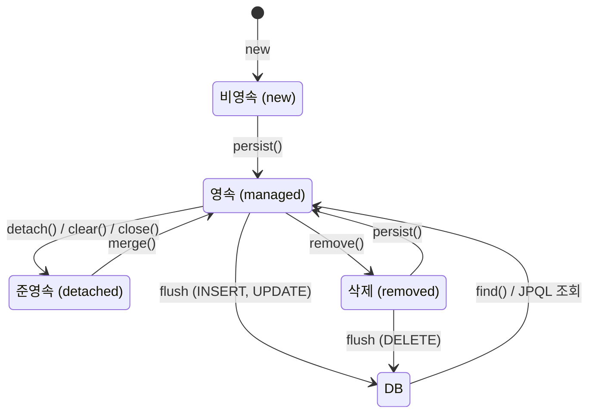

# 영속성 컨텍스트 / Entity Lifecycle

## JPA와 ORM

JPA(Jakarta Persistence API)는 자바의 ORM 표준 명세다. 실제 구현체는 대부분 Hibernate를 쓴다.

ORM은 객체와 테이블 사이의 차이를 대신 메워준다.

- 객체는 참조(`order.getMember()`)로 연관을 따라가고, 테이블은 외래 키와 조인을 쓴다.
- 객체는 상속이 있고 테이블은 없다.
- 같은 행을 두 번 조회했을 때 객체는 `==`로 비교할 수 있어야 하는데, SQL만 쓰면 매번 새 객체가 생긴다.

JPA는 이 차이를 영속성 컨텍스트라는 중간 계층으로 해결한다.

## 영속성 컨텍스트 (Persistence Context)

영속성 컨텍스트는 **엔티티를 영구 저장하는 환경**이다. 애플리케이션과 DB 사이에서 엔티티를 담아두는 논리적인 공간이라고 보면 된다.

```java
em.persist(member);   // DB에 바로 저장하는 게 아니라 영속성 컨텍스트에 넣는다
```

- `EntityManager`를 통해 영속성 컨텍스트에 접근한다.
- 영속성 컨텍스트가 주는 기능은 다음과 같다.
  - 1차 캐시
  - 동일성 보장
  - 쓰기 지연 (transactional write-behind)
  - 변경 감지 (Dirty Checking)
  - 지연 로딩 (Lazy Loading)

### EntityManagerFactory와 EntityManager

| | EntityManagerFactory | EntityManager |
| --- | --- | --- |
| 생성 비용 | 크다 | 작다 |
| 개수 | 애플리케이션에 하나 | 요청(트랜잭션)마다 하나 |
| 스레드 공유 | 가능 | 불가 |

`EntityManager`는 DB 커넥션을 쓰는 객체라 스레드끼리 공유하면 안 된다.

### Spring에서의 영속성 컨텍스트

Spring에서 주입받는 `EntityManager`는 실제 객체가 아니라 프록시다.

```java
@Repository
@RequiredArgsConstructor
public class MemberRepository {
    private final EntityManager em;   // 공유 EntityManager 프록시
}
```

- 프록시는 호출될 때 **현재 트랜잭션에 묶인 진짜 EntityManager**를 찾아서 일을 넘긴다.
- 그래서 싱글톤 빈에 주입해도 스레드마다 다른 영속성 컨텍스트를 쓴다.
- 기본 전략은 **트랜잭션 범위 영속성 컨텍스트**다. 트랜잭션이 시작할 때 만들어지고 끝날 때 사라진다.
- 같은 트랜잭션 안이면 Repository가 달라도 같은 영속성 컨텍스트를 쓴다.



## 엔티티 생명주기



### 비영속 (new / transient)

```java
Member member = new Member("kim");
```

객체만 만들었고 영속성 컨텍스트와 아무 관계가 없다.

### 영속 (managed)

```java
em.persist(member);
Member found = em.find(Member.class, 1L);   // 조회한 엔티티도 영속 상태
```

- 영속성 컨텍스트가 관리하는 상태다.
- 1차 캐시, 변경 감지, 지연 로딩은 모두 영속 상태일 때만 동작한다.
- `persist()`를 해도 바로 INSERT가 나가지 않는다. 커밋이나 flush 시점에 나간다.
  - 예외로 `@GeneratedValue(strategy = IDENTITY)`는 DB가 ID를 만들어서 `persist()` 시점에 INSERT를 바로 실행한다. 1차 캐시에 넣으려면 ID가 필요하기 때문이다.

### 준영속 (detached)

```java
em.detach(member);   // 특정 엔티티만 분리
em.clear();          // 영속성 컨텍스트 초기화
em.close();          // 영속성 컨텍스트 종료
```

- 한 번 영속 상태였다가 영속성 컨텍스트에서 분리된 상태다.
- ID는 있지만 변경 감지도, 지연 로딩도 안 된다.
- 트랜잭션이 끝난 뒤 컨트롤러로 넘어간 엔티티가 보통 준영속이다. (OSIV를 끈 경우)

준영속 엔티티를 다시 저장하는 방법은 두 가지다.

- **변경 감지 (권장)**: 트랜잭션 안에서 ID로 다시 조회하고 필요한 필드만 바꾼다.
- **`merge()`**: 준영속 엔티티의 값으로 영속 엔티티를 찾아 모든 필드를 덮어쓴다. 값이 없는 필드는 `null`로 바뀔 수 있어서 위험하다.

```java
@Transactional
public void updateName(Long id, String name) {
    Member member = memberRepository.findById(id).orElseThrow();  // 영속 상태로 조회
    member.changeName(name);                                      // 커밋 시 UPDATE
}
```

Spring Data JPA의 `save()`는 새 엔티티면 `persist()`, 아니면 `merge()`를 호출한다. 그래서 수정은 `save()`보다 변경 감지로 하는 편이 낫다.

### 삭제 (removed)

```java
em.remove(member);
```

삭제하기로 표시한 상태다. flush 시점에 DELETE가 나간다.
