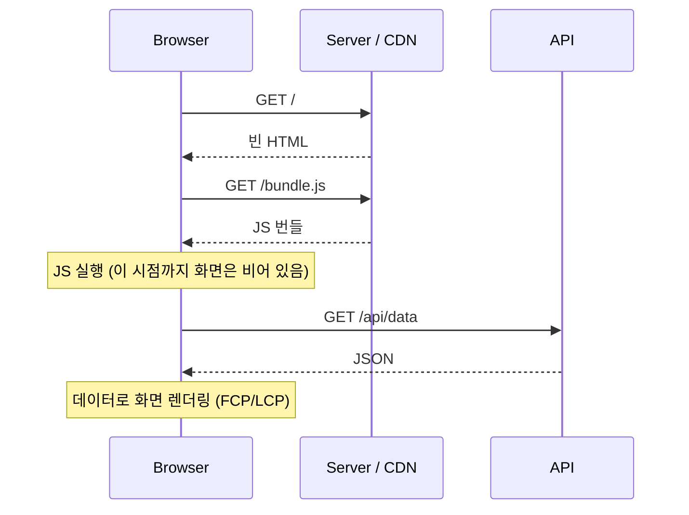
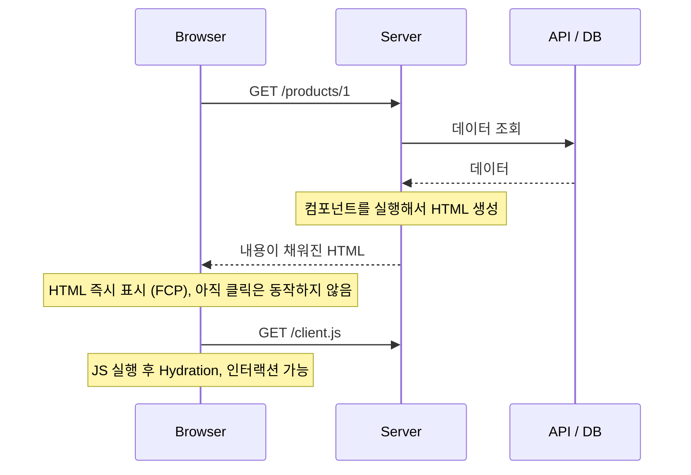

# [Week 12] 12주차 Rendering Architecture 정리

## 목차

1. [SPA/MPA](#1-spampa)
2. [CSR/SSR/SSG](#2-csrssrssg)
3. [Hydration](#3-hydration)
4. [Server/Client Component](#4-serverclient-component)
5. [정리](#5-정리)

> 11주차까지는 브라우저 안에서 일어나는 렌더링을 다뤘다면, 이번 주는 **그 렌더링을 서버와 브라우저 중 어디에서, 언제 할지를** 다룸

---

## 1. SPA/MPA

### 개념

- **MPA(Multi Page Application)**: 페이지를 이동할 때마다 서버에서 새 HTML 문서를 받아 **화면 전체를 교체하는** 전통적인 방식
- **SPA(Single Page Application)**: HTML 문서를 **처음에 한 번만** 받고, 이후 화면 갱신과 페이지 이동은 JS가 처리하는 방식

```
[MPA]
링크 클릭 → 서버에 HTML 요청 → HTML 응답 → 브라우저가 문서 전체를 교체

[SPA]
최초 방문: 빈 HTML + JS 번들 다운로드 → JS 실행 → 화면 렌더
이동:      링크 클릭 → JS가 URL 변경 → 필요한 데이터만 fetch → 바뀐 부분만 갱신
```

### SPA의 클라이언트 라우팅

- 링크를 눌러도 문서를 새로 요청하지 않고, **History API로 주소만 바꾼 뒤** 그 주소에 맞는 화면을 JS가 그림

```js
const routes = { '/': renderHome, '/about': renderAbout };

function render(path) {
  (routes[path] ?? renderNotFound)();
}

document.addEventListener('click', (e) => {
  const link = e.target.closest('a[data-link]');
  if (!link) return;
  e.preventDefault();                    // 기본 동작(문서 요청)을 막음
  history.pushState({}, '', link.href);  // 주소만 변경, 새로고침 없음
  render(location.pathname);
});

window.addEventListener('popstate', () => render(location.pathname)); // 뒤로가기/앞으로가기
```

- React Router 같은 라이브러리가 이 과정을 대신 처리함

### 비교

| | MPA | SPA |
|---|---|---|
| 페이지 이동 | 문서 전체를 새로 로드 | 필요한 부분만 JS로 갱신 |
| 초기 로딩 | 해당 페이지 HTML만 받아서 가벼움 | 앱을 구동할 JS 번들이 필요 |
| 이후 이동 | 매번 서버 왕복 | 데이터만 요청해서 빠름 |
| 상태 | 이동하면 JS 상태가 사라짐 | 이동해도 유지됨 |
| 검색 노출 | HTML에 내용이 있어 유리 | JS 실행이 필요해 불리할 수 있음 |

### SPA에서 직접 챙겨야 하는 것

- **초기 번들 크기**: 앱 전체를 한 번에 받으면 첫 화면이 늦어짐 → 코드 분할로 줄임
- **SEO와 링크 미리보기**: JS를 실행하지 않는 크롤러는 빈 HTML만 봄
- **접근성**: 페이지 이동 시 포커스 이동, `<title>` 갱신을 직접 처리해야 함
- **스크롤 복원**: 뒤로가기 시 스크롤 위치를 직접 복원해야 함
- **메모리**: 탭을 오래 열어 두므로 누수가 쌓이기 쉬움 (3주차)

### MPA의 보완 기능

- MPA의 단점이던 **이동 시 깜빡임과 느린 전환을** 브라우저 기능이 줄여주고 있음 (브라우저별 지원 확인 필요)
- **bfcache**: 뒤로가기 시 이전 페이지를 메모리에서 그대로 복원
- **Speculation Rules**: 이동할 가능성이 높은 페이지를 미리 가져오거나(prefetch) 미리 렌더(prerender)
- **Cross-document View Transitions**: 문서가 바뀌어도 전환 애니메이션 적용

### SPA/MPA와 CSR/SSR/SSG는 다른 구분

- SPA/MPA: **페이지 전환 방식에** 대한 구분. 이동할 때 문서를 새로 받는지가 기준
- CSR/SSR/SSG: **HTML을 만드는 시점과 장소에** 대한 구분. 서버가 만드는지 브라우저가 만드는지가 기준
- 두 구분은 **조합할 수 있음**
  - Next.js는 첫 방문에는 SSR로 HTML을 받음
  - 이후 이동은 SPA처럼 JS가 처리

### 선택 기준

- 블로그, 문서, 뉴스처럼 **콘텐츠 중심이고 검색 노출이 중요하면** MPA 또는 SSR/SSG 기반
- 대시보드, 에디터, 어드민처럼 **상호작용 중심이고 로그인 뒤에 쓰는** 서비스는 SPA
- 둘이 섞여 있으면 페이지별로 방식을 고를 수 있는 프레임워크(Next.js, Remix, Astro)를 사용

---

## 2. CSR/SSR/SSG

### 개념

- 세 방식의 차이는 **사용자가 보는 HTML을 누가, 언제 만드는가**

```
            빌드 시점             요청 시점                   브라우저
SSG   ──  HTML 미리 생성  ──→  CDN이 파일 그대로 전달   ──→  화면 표시 → Hydrate
SSR   ──                        서버가 요청마다 HTML 생성 ──→  화면 표시 → Hydrate
CSR   ──                        거의 빈 HTML 전달         ──→  JS가 DOM을 만들어 표시
```

### CSR (Client-Side Rendering)

- 서버는 **빈 HTML과 JS 번들만** 보내고, 브라우저가 JS를 실행해서 화면을 만듦
- 데이터도 브라우저에서 API로 요청함

```html
<!-- 서버가 보내는 HTML: 내용이 없음 -->
<body>
  <div id="root"></div>
  <script src="/bundle.js"></script>
</body>
```



- HTML → JS → 데이터 순서로 요청이 이어지는 **워터폴** 때문에 첫 콘텐츠가 늦게 나옴 (10주차 FCP, LCP)

| 장점 | 단점 |
|---|---|
| 서버가 단순함 (정적 파일 + CDN으로 충분) | 초기 로딩이 느림 (빈 화면 → 스켈레톤 → 콘텐츠) |
| 이동 후 상호작용이 빠르고 풍부함 | SEO, 링크 미리보기에 불리 |
| 서버 비용이 낮음 | JS 실행에 실패하면 아무것도 안 보임 |

- 로그인 뒤의 대시보드, 어드민처럼 **SEO가 필요 없는 앱에** 적합

### SSR (Server-Side Rendering)

- **요청이 올 때마다** 서버가 컴포넌트를 실행해서 완성된 HTML을 응답함
- 브라우저는 JS를 기다리지 않고 HTML을 바로 표시하고, 이후 JS가 로드되면 **Hydration**(3장)으로 인터랙션을 연결함



```jsx
// 개념을 보여주는 최소 예시 (React + Express)
import { renderToString } from 'react-dom/server';

app.get('*', async (req, res) => {
  const data = await fetchData(req.path);
  const html = renderToString(<App data={data} />);   // 서버에서 HTML 문자열 생성

  // 초기 데이터를 HTML에 심어서 클라이언트가 다시 요청하지 않게 함
  // '<'를 이스케이프하지 않으면 </script> 삽입으로 XSS가 가능 (7주차)
  const json = JSON.stringify(data).replace(/</g, '\\u003c');

  res.send(`<!doctype html>
    <div id="root">${html}</div>
    <script>window.__DATA__ = ${json}</script>
    <script src="/client.js" defer></script>`);
});
```

| 장점 | 단점 |
|---|---|
| HTML에 내용이 있어 **FCP/LCP가 빠름** | 요청마다 서버가 계산하므로 **TTFB가 늘어남** |
| SEO, 링크 미리보기에 유리 | 서버 비용과 확장 부담 |
| 요청 시점의 최신 데이터, 쿠키 기반 개인화 가능 | 사용자별 응답이라 CDN 캐시가 어려움 |
| | Hydration 때문에 JS 번들은 여전히 필요 |
| | 서버에서도 실행되므로 `window`, `document`를 바로 쓸 수 없음 |

- **보이지만 아직 눌러도 반응이 없는 구간이** 생김 (HTML 표시 ~ Hydration 완료). 3장에서 자세히 다룸

#### Streaming SSR

- 모든 데이터가 준비될 때까지 기다렸다가 HTML을 한 번에 보내지 않고, **준비된 부분부터 조각으로** 보냄
- 느린 부분은 `Suspense`의 fallback을 먼저 보여주고, 준비되면 같은 연결로 나중에 채움

```
일반 SSR  :  [모든 데이터 대기 ......] → HTML 전체 전송 → 표시
Streaming :  [Header, 본문 준비] → 즉시 전송/표시
                         [느린 댓글 준비] → 이어서 전송 (fallback 자리에 채워짐)
```

### SSG (Static Site Generation)

- **빌드 시점에** 모든 페이지의 HTML을 미리 만들어 둠
- 요청이 오면 서버 계산 없이 정적 파일 그대로 CDN에서 전달함

| 장점 | 단점 |
|---|---|
| **가장 빠른 응답** (CDN에서 파일 전달) | 데이터가 바뀌면 다시 빌드/배포해야 함 |
| 서버 비용이 낮고 장애 가능성이 적음 | 페이지 수가 많으면 빌드 시간이 길어짐 |
| SEO에 유리, 캐싱이 쉬움 (5주차) | 사용자별 개인화 어려움 (클라이언트에서 보완) |

- 블로그, 문서, 랜딩 페이지처럼 **자주 바뀌지 않는 콘텐츠에** 적합

```jsx
// 동적 경로도 빌드 시점에 목록을 만들어 미리 생성 (Next.js App Router 예시)
export async function generateStaticParams() {
  const posts = await getPosts();
  return posts.map((post) => ({ slug: post.slug }));
}
```

#### ISR (Incremental Static Regeneration)

- 정적 페이지의 장점은 유지하고, **일정 시간이 지나면 백그라운드에서 페이지를 다시 생성하는** 방식
- 5주차 HTTP Cache의 **stale-while-revalidate와** 같은 아이디어

```
유효 기간 안의 요청   → 캐시된 정적 페이지를 즉시 응답
유효 기간 경과 후 요청 → 기존 페이지를 즉시 응답 + 백그라운드에서 새로 생성
다음 요청             → 새로 생성된 페이지 응답
```

```jsx
export const revalidate = 60;   // 60초마다 재생성 (설정 방식은 프레임워크 버전마다 다름)
```

- 상품 상세, 기사처럼 가끔 바뀌지만 요청마다 서버가 계산할 필요는 없는 콘텐츠에 적합
- 데이터가 바뀌는 시점에 즉시 재생성하는 on-demand 방식도 있음

### 비교

| | CSR | SSR | SSG (ISR) |
|---|---|---|---|
| HTML 생성 시점 | 브라우저 실행 시 | 요청마다 | 빌드 시 (ISR은 주기적) |
| 초기 화면 (FCP) | 느림 | 빠름 | 가장 빠름 |
| TTFB | 빠름 (빈 HTML) | 상대적으로 느림 | 매우 빠름 (CDN) |
| SEO | 불리 | 유리 | 유리 |
| 개인화 | 쉬움 | 가능 | 어려움 |
| 서버 부하 | 낮음 | 높음 | 매우 낮음 |
| CDN 캐시 | 쉬움 | 어려움 | 쉬움 |

### 한 앱에서 섞어 쓰기

- 요즘 프레임워크는 **페이지(경로)마다 렌더링 방식을 따로** 고를 수 있음
- 랜딩, 소개 페이지: SSG
- 블로그 글, 상품 상세: SSG + ISR
- 검색 결과, 개인화 추천: SSR
- 마이페이지, 대시보드: CSR
- 일부 프레임워크는 한 페이지 안에서 정적인 부분은 미리 만들고 동적인 부분만 요청 시 채우는 방식도 지원함 (용어와 범위는 프레임워크별로 다름)

---

## 3. Hydration

### 개념

- 서버가 만든 HTML에 **JS를 연결해서 이벤트 핸들러와 상태를 붙이는** 과정
- 서버가 만든 HTML은 보이기만 할 뿐 동작하지 않음
  - HTML에는 `onClick` 같은 핸들러와 컴포넌트 상태가 없음
  - 그래서 브라우저에서 **같은 컴포넌트를 다시 실행해서**, 이미 화면에 있는 DOM에 핸들러와 상태를 연결함

### 동작 과정

```
1. 서버      컴포넌트 실행 → HTML 생성 (+ 초기 데이터 직렬화)
2. 브라우저  HTML 즉시 표시 (FCP), 아직 클릭해도 반응 없음
3. 브라우저  JS 번들 다운로드, 파싱, 실행
4. React    같은 컴포넌트를 클라이언트에서 렌더 → 기존 DOM과 매칭 → 이벤트 핸들러 연결
5. 완료      인터랙션 가능 (체감 지표는 INP)
```

```jsx
import { hydrateRoot, createRoot } from 'react-dom/client';

// Hydration: 서버가 만든 DOM을 재사용하면서 이벤트와 상태만 연결
hydrateRoot(document.getElementById('root'), <App data={window.__DATA__} />);

// CSR: 비어 있는 컨테이너에 처음부터 DOM을 새로 생성
createRoot(document.getElementById('root')).render(<App />);
```

### Hydration Mismatch

- 서버가 만든 HTML과 **클라이언트의 첫 렌더 결과가 다르면** React가 경고를 내고, 불일치한 부분을 클라이언트에서 다시 렌더함
- 같은 입력이면 서버와 클라이언트가 같은 결과를 내야 함 (11주차 렌더링의 순수성)

| 원인 | 예시 | 해결 |
|---|---|---|
| 시간, 랜덤 값 | `new Date()`, `Math.random()` | 마운트 후 `useEffect`에서 설정 |
| 브라우저 전용 값 | `window.innerWidth`, `localStorage` | `useEffect` 안에서 읽기 |
| 타임존/로케일 차이 | `toLocaleString()` | 로케일 고정 또는 클라이언트에서 포맷 |
| 잘못된 HTML 중첩 | `<p>` 안의 `<div>` | 올바른 구조로 수정 (브라우저가 파싱 중 보정해서 서버 HTML과 달라짐) |

```jsx
// 문제: 서버와 클라이언트의 시각이 달라서 Mismatch
function Clock() {
  return <p>{new Date().toLocaleTimeString()}</p>;
}

// 해결: 첫 렌더는 서버와 같은 값(빈 값)으로, 마운트 후에 클라이언트 값 표시
function Clock() {
  const [now, setNow] = useState(null);
  useEffect(() => setNow(new Date()), []);   // useEffect는 서버에서 실행되지 않음
  return <p>{now ? now.toLocaleTimeString() : ''}</p>;
}
```

### Hydration의 비용

- **JS 다운로드**: HTML이 이미 있어도 컴포넌트 코드 전체를 받아야 함
- **중복 실행**: 서버에서 한 렌더를 클라이언트에서 또 수행
- **데이터 중복**: HTML과 직렬화된 초기 데이터(JSON)를 둘 다 전송
- **메인 스레드 점유**: 큰 페이지는 Long Task가 되어 그동안 클릭이 처리되지 않음 (9주차)
- 화면은 빨리 보이는데(FCP, LCP 양호) **누르면 반응이 느린(INP 불량)** 현상의 주된 원인

### Hydration 줄이기

- **번들 줄이기**: 코드 분할, 불필요한 라이브러리 제거
- **Selective Hydration (React 18)**: `Suspense` 경계 단위로 나눠서 hydrate하고, 사용자가 상호작용한 부분을 먼저 처리
- **Islands Architecture**: 페이지는 정적 HTML로 두고, **인터랙티브한 부분(섬)만** hydrate (Astro)
- **Resumability**: hydration 없이 서버가 직렬화한 상태에서 이어서 실행하고, 필요한 코드는 이벤트 시점에 로드 (Qwik)
- **Server Components**: 서버 전용 컴포넌트는 번들과 hydration 대상에서 제외 (4장)

```
┌──────────── 정적 HTML (hydrate 하지 않음) ────────────┐
│  Header     Article text ...                          │
│          ┌─── island ───┐      ┌─── island ───┐       │
│          │  Like button │      │  Comment box │       │
│          └──────────────┘      └──────────────┘       │
└───────────────────────────────────────────────────────┘
          섬(인터랙티브한 부분)만 JS를 받아서 hydrate
```

```jsx
// Selective Hydration: Comments가 늦어도 나머지를 막지 않고 따로 hydrate됨
<Layout>
  <Header />
  <Suspense fallback={<Spinner />}>
    <Comments />
  </Suspense>
</Layout>
```

### 서버 데이터를 클라이언트 캐시로 넘기기

- SSR에서 서버가 미리 가져온 데이터를 **직렬화해서 클라이언트 캐시로 복원하면**, 클라이언트가 같은 데이터를 다시 요청하지 않음 (6주차 Server State)

```jsx
// 서버: 데이터를 미리 가져와서 캐시를 직렬화
const queryClient = new QueryClient();
await queryClient.prefetchQuery({ queryKey: ['posts'], queryFn: getPosts });

return (
  <HydrationBoundary state={dehydrate(queryClient)}>
    <Posts />   {/* 클라이언트에서 useQuery(['posts'])를 호출해도 재요청 없음 */}
  </HydrationBoundary>
);
```

### 보안 주의

- HTML에 직렬화해서 심는 데이터는 **모든 사용자가 볼 수 있음** → 민감 정보를 넣으면 안 됨
- 직렬화 데이터에 `</script>`가 들어 있으면 XSS가 되므로 **이스케이프 필수** (7주차)

---

## 4. Server/Client Component

### 개념

- **React Server Components(RSC)**: 컴포넌트를 **실행 위치에 따라** 나누는 구조
  - **Server Component**: 서버에서만 실행
  - **Client Component**: 브라우저에서도 실행
- Server Component의 코드는 **브라우저로 전송되지 않고**, hydration 대상도 아님
- Next.js App Router에서는 모든 컴포넌트가 기본적으로 Server Component
  - 상호작용이 필요한 파일에 `'use client'`를 선언하면 Client Component가 됨

### SSR과 Server Component의 차이

| | SSR | Server Component |
|---|---|---|
| 무엇에 대한 개념 | HTML을 만드는 방식 (렌더링 시점) | 컴포넌트가 실행되는 위치 |
| 코드를 브라우저로 전송 | 함 (hydration에 필요) | 안 함 |
| 클라이언트에서 다시 실행 | 함 | 안 함 |

- 서로 **독립적인 개념이라** 함께 쓰임. Client Component도 초기에는 서버에서 SSR로 HTML이 만들어지고 hydrate됨

### 두 컴포넌트의 특성

| | Server Component | Client Component |
|---|---|---|
| 선언 | 기본값 | 파일 상단에 `'use client'` |
| 실행 위치 | 서버 | 서버(초기 SSR) + 브라우저 |
| 번들 포함 | 포함되지 않음 (쓴 라이브러리도 제외) | 포함됨 |
| 데이터 접근 | DB, 파일, 비밀 키에 직접 접근 | 브라우저에서 API로 요청 |
| `useState`, `useEffect` | 사용 불가 | 사용 가능 |
| 이벤트 핸들러, 브라우저 API | 사용 불가 | 사용 가능 |

### 예시

```jsx
// app/posts/page.jsx — Server Component (기본값)
import { db } from '@/lib/db';
import LikeButton from './LikeButton';

export default async function PostsPage() {
  const posts = await db.post.findMany();   // 서버에서 DB를 직접 조회 (별도 API 불필요)

  return posts.map((post) => (
    <article key={post.id}>
      <h2>{post.title}</h2>
      <p>{post.body}</p>
      <LikeButton postId={post.id} initial={post.likes} />   {/* 상호작용이 필요한 부분만 Client */}
    </article>
  ));
}
```

```jsx
// app/posts/LikeButton.jsx — Client Component
'use client';
import { useState } from 'react';

export default function LikeButton({ postId, initial }) {
  const [likes, setLikes] = useState(initial);
  return <button onClick={() => setLikes((n) => n + 1)}>좋아요 {likes}</button>;
}
```

### 'use client' 경계

- `'use client'`를 선언한 파일과 **그 파일이 import하는 모든 모듈이** 클라이언트 번들에 포함됨
- 경계를 트리 위쪽에 두면 하위 전체가 클라이언트 코드가 되어 Server Component의 이점이 사라짐
- 그래서 **가능한 한 아래(leaf)로** 내려서 필요한 부분만 Client로 만듦

```
Layout (Server)
├─ Header (Server)
├─ PostList (Server) ── DB 조회
│   └─ LikeButton ('use client')   ← 여기부터 아래는 클라이언트 번들에 포함
└─ Footer (Server)
```

### 합성 규칙

- Server Component는 Client Component를 **import해서 쓸 수 있음**
- Client Component는 Server Component를 **import할 수 없음** (서버 코드가 클라이언트 번들에 들어가기 때문)
- 대신 `children`이나 props로 **전달하면 가능**

```jsx
// Modal.jsx
'use client';
export default function Modal({ children }) {
  const [open, setOpen] = useState(false);
  return (
    <>
      <button onClick={() => setOpen(true)}>열기</button>
      {open && <div className="modal">{children}</div>}
    </>
  );
}

// page.jsx (Server Component)
<Modal>
  <ServerRenderedContent />   {/* 서버에서 렌더된 결과가 Modal 안에 전달됨 */}
</Modal>
```

- Server에서 Client로 넘기는 props는 **직렬화 가능한 값만** 가능 (문자열, 숫자, 객체, 배열, 날짜 등)
- 함수나 클래스 인스턴스는 전달 불가

### RSC Payload

- 서버가 Server Component를 실행한 결과를 **React 트리를 직렬화한 데이터(RSC Payload)로** 만들어 브라우저에 전달함
- Payload에는 Server Component의 렌더 결과와 Client Component의 위치/참조가 들어 있음

```
서버
 ├─ Server Component 실행 (DB/API 접근)
 ├─ RSC Payload 생성 (직렬화된 트리 + Client Component 참조)
 └─ 초기 요청이면 HTML도 생성 (SSR)
        │
        ▼
브라우저
 ├─ HTML을 즉시 표시
 ├─ Client Component의 JS만 다운로드
 └─ Payload로 트리를 복원하고 Client Component만 hydrate
```

- 이후 페이지 이동에서는 HTML 전체 대신 **Payload만 받아서 기존 트리와 병합** (11주차 Reconciliation)
- 그래서 Client Component의 상태가 유지됨

### 얻는 이점

- **번들 크기 감소**: 서버에서만 쓰는 코드와 라이브러리(마크다운 파서 등)가 브라우저로 가지 않음
- **Hydration 비용 감소**: hydrate할 컴포넌트가 줄어서 INP 개선
- **데이터 워터폴 감소**: DB와 가까운 서버에서 가져오므로 브라우저 → API 왕복이 사라짐
- **보안**: 비밀 키와 내부 로직이 서버에 머묾

```jsx
// 서버에서 독립적인 요청은 병렬로 처리
export default async function Page() {
  const [user, posts] = await Promise.all([getUser(), getPosts()]);   // 순차 처리하면 시간이 합산됨
  return <Dashboard user={user} posts={posts} />;
}
```

### 서버 전용 코드 보호

- DB 접근 코드나 비밀 키가 실수로 클라이언트에 포함되지 않게 해야 함 (7주차)

```js
import 'server-only';   // 클라이언트 코드에서 import하면 빌드 에러가 남

export async function getSecretData() { /* DB 조회 */ }
```

- 환경 변수는 보통 **공개용 접두사(예: `NEXT_PUBLIC_`)가 붙은 것만** 브라우저로 노출됨
- 비밀 값에는 공개용 접두사를 붙이지 않도록 주의

### Server Actions

- 클라이언트에서 **서버의 함수를 호출하는** 방식. 주로 데이터 변경에 사용

```jsx
'use server';

export async function addComment(formData) {
  const user = await getSessionUser();
  if (!user) throw new Error('unauthorized');   // 인가 검사는 액션 안에서 직접 수행

  await db.comment.create({ data: { userId: user.id, text: formData.get('text') } });
  revalidatePath('/posts');                     // 관련 캐시 무효화
}
```

- Server Action은 내부적으로 **공개된 HTTP 엔드포인트**
- 그래서 호출 권한 검증과 입력 검증을 **항상 액션 내부에서** 해야 함

### 무엇을 Server로, 무엇을 Client로

| 하려는 일 | 선택 |
|---|---|
| 데이터 조회, 정적 콘텐츠 표시 | Server |
| 비밀 키, DB 접근 | Server |
| 큰 라이브러리를 쓰는 렌더 (마크다운, 코드 하이라이팅) | Server |
| `useState`, `useEffect`, 이벤트 핸들러 | Client |
| 브라우저 API (`localStorage`, `window`) | Client |
| 사용자 입력 기반 요청 (검색창 자동완성) | Client |
| Context Provider | Client (Provider만 Client로 두고 `children`은 Server로 유지) |

### 주의할 점

- **직렬화 경계를** 의식해야 함 (함수, 클래스 인스턴스는 Server에서 Client로 전달 불가)
- `useState` 등을 쓰는 외부 라이브러리 컴포넌트는 `'use client'` 파일로 감싸서 사용
- 캐싱 동작이 프레임워크마다, 버전마다 달라서 공식 문서 확인 필요
- RSC는 React만으로 쓸 수 없고 **번들러와 프레임워크가 함께 구현해야** 함 (Next.js App Router 등)

---

## 5. 정리

| 개념 | 핵심 |
|---|---|
| SPA/MPA | 페이지 이동 방식의 차이. MPA는 문서를 새로 받고, SPA는 JS가 화면을 갱신 |
| CSR | 브라우저가 HTML 생성. 초기 로딩은 느리지만 이동 후 빠름. 대시보드에 적합 |
| SSR | 요청마다 서버가 HTML 생성. 초기 화면과 SEO에 유리, 서버 부하와 TTFB 증가 |
| SSG/ISR | 빌드 시 HTML 생성. 가장 빠르고 저렴하지만 데이터 갱신이 어려움, ISR로 보완 |
| Hydration | 서버 HTML에 JS를 연결해 인터랙티브하게 만드는 과정. 비용이 크고 Mismatch 주의 |
| Server/Client Component | 서버에서만 실행되는 컴포넌트는 번들과 hydration에서 제외. `'use client'` 경계는 아래로 |

### 시나리오별 선택

| 서비스 | 권장 |
|---|---|
| 개인 블로그, 기술 문서 | SSG (+ ISR) |
| 쇼핑몰 상품 상세 | SSG + ISR, 재고/가격만 Client에서 갱신 |
| 쇼핑몰 검색/추천 | SSR |
| 로그인 후 대시보드, 어드민 | CSR |
| 뉴스 | ISR 또는 SSR + 스트리밍 |
| 콘텐츠 + 일부 인터랙션 | Islands(Astro) 또는 Server Components |

### 체크리스트

- 이 페이지는 SEO가 필요한가, 사용자별 데이터인가, 얼마나 자주 바뀌는가
- SSR 페이지의 TTFB가 느리지 않은가, 캐시할 수 있는 부분은 없는가
- 화면은 빨리 뜨는데 클릭 반응이 느리지 않은가, Mismatch 경고는 없는가
- `'use client'` 경계가 필요 이상으로 위에 있지 않은가
- 직렬화하는 데이터에 민감 정보가 없는가, 서버 전용 코드가 클라이언트로 새지 않는가